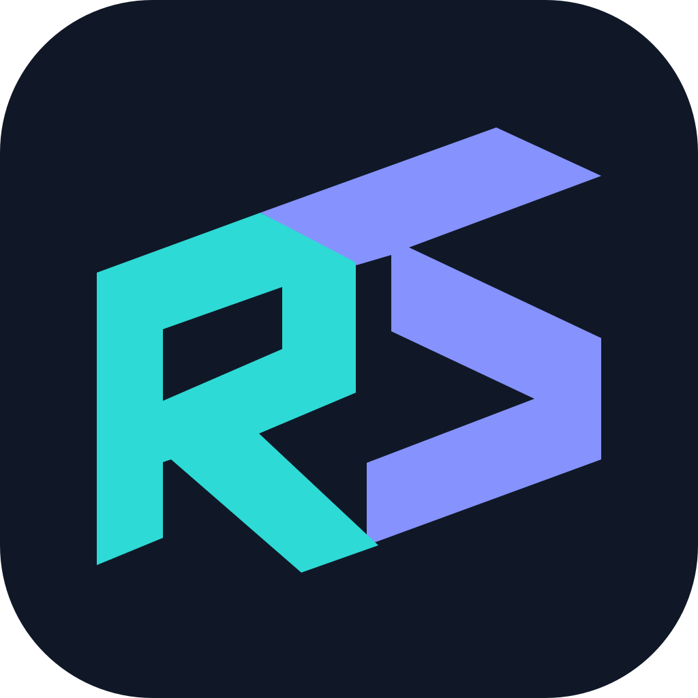
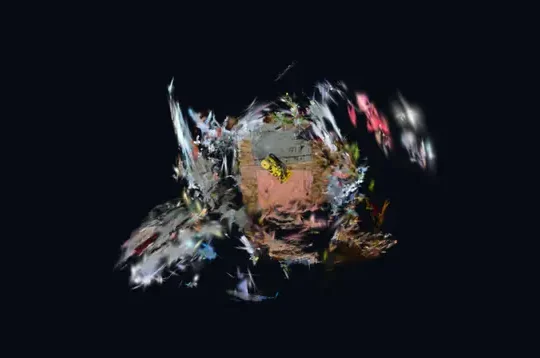

<p align="center">
  
</p>

<h1 align="center">ReScene</h1>

<p align="center">Turn photos and videos into 3D Gaussian splat scenes you can inspect, export and share.</p>

<p align="center">
  English ·
  <a href="README.zh-CN.md" hreflang="zh-CN" lang="zh-CN">简体中文</a>
</p>

<p align="center">
  <a href="https://github.com/FLmhp/ReScene/actions/workflows/check.yml"></a>
  <a href="https://github.com/FLmhp/ReScene/releases"></a>
  <a href="LICENSE"></a>
</p>

<p align="center">
  <a href="https://rescene.xyz/">Website</a> ·
  <a href="https://app.rescene.xyz/">Workbench</a> ·
  <a href="https://github.com/FLmhp/ReScene/releases">Downloads</a>
</p>

## Overview & when to use

ReScene is one repository for the whole reconstruction loop: a workbench (Web, Tauri desktop, Expo Android, Taro WeChat mini program), a FastAPI control plane with a PostgreSQL lease queue, a GPU worker that stores inputs and artifacts in private OSS, and a Python engine that runs VGGT, COLMAP and gsplat.

Reach for it when you can shoot a set of overlapping photos or one continuous video around a static scene or object, and you want a splat you can browse, download and hand to someone else — without assembling a geometry pipeline, a job queue, project permissions and signed artifact delivery yourself.

It is not a metrology or CAD tool, and nothing here is a promise about throughput or reconstruction accuracy. Results depend on capture, route and hardware.

## Why ReScene

The workbench joins the steps that are otherwise separate tools. Every step below is served by routes in `src/rescene_api` and `src/rescene_worker`:

1. **Upload.** Photos or a video go straight from the client to private OSS through an upload session (`/v1/projects/{project_id}/assets/upload-session`, then `/v1/assets/{asset_id}/complete`); media never transits the API server.
2. **Queue.** Creating a job with a route (`POST /v1/projects/{project_id}/jobs`) puts it in a PostgreSQL lease queue. A GPU worker claims it, heartbeats, and reports per-stage progress and logs.
3. **Watch and recover.** Task status, stage history and logs are readable (`/v1/jobs/{job_id}`, `/v1/jobs/{job_id}/stages`, `/v1/jobs/{job_id}/logs`); a job can be cancelled or retried, and the worker resumes from recorded stages after a disconnect.
4. **Inspect.** The Viewer renders PLY and SPZ in the browser with WebGL.
5. **Deliver.** The reconstruction manifest (`/v1/reconstructions/{reconstruction_id}/manifest`) returns signed URLs, sizes and SHA-256 values for each artifact, including the scene in SPZ and PLY.
6. **Share.** A share (`POST /v1/reconstructions/{reconstruction_id}/shares`) is a token with an expiry; the public link and its QR code work until the share is revoked (`DELETE /v1/shares/{share_id}`).

Compared with the tools it builds on, the advantage is workflow integration, not speed or quality:

| | Scope | What you still wire yourself |
|---|---|---|
| [COLMAP](https://colmap.github.io/) | Structure-from-motion and multi-view stereo (SfM/MVS), with its own GUI and CLI | Queueing, project state, permissions, viewer, delivery and sharing |
| [Nerfstudio Splatfacto](https://docs.nerf.studio/nerfology/methods/splat.html) | Gaussian splat training, a viewer and PLY export | Serving that to a team: accounts, project state, GPU job queue, signed delivery, revocable links |
| ReScene | Route selection, queueing, project state, viewer, SPZ/PLY delivery and revocable shares in one workflow, on top of VGGT, COLMAP and gsplat | OSS, CUDA GPU capacity and its own model weights |

COLMAP and Splatfacto are mature engines with their own viewers and exporters; ReScene wraps established engines rather than claiming to beat them.

## Routes & clients

Routes come from `src/rescene/config.py::PROFILES`:

| Route | Geometry | Scene optimization steps | Max input frames | Notes |
|---|---|---:|---:|---|
| `FAST` | VGGT | 7,000 | 80 | No bundle adjustment |
| `BALANCED` (default) | VGGT + bundle adjustment | 20,000 | 80 | No dense reconstruction |
| `QUALITY` | COLMAP SfM / BA / MVS | 20,000 | 250 | Includes COLMAP dense reconstruction |

The step counts are per-scene Gaussian optimization steps, not retraining of VGGT: VGGT runs inference with pretrained weights.

| Client | State |
|---|---|
| Web workbench | <https://app.rescene.xyz/> — the current release is deployed there |
| Windows | `ReScene_0.5.1_x64-setup.exe` in [Releases](https://github.com/FLmhp/ReScene/releases); built in CI, not code-signed, no local install test recorded |
| Linux | `ReScene_0.5.1_amd64.deb` and `ReScene_0.5.1_amd64.AppImage` in Releases; built in CI, no install test recorded |
| macOS | `ReScene_0.5.1_universal.dmg` in Releases; built in CI, not signed or notarized |
| Android | `app-release.apk` in Releases; signed with the release keystore, not distributed through an app store |
| WeChat mini program | Source and development builds only; not published to the WeChat store |

Project collaboration is by invitation: the inviter issues a one-time claim code bound to an invited email address and forwards the code to that person by hand. ReScene does not send invitation emails.

<p align="center">
  
  <br>
  <sub>Scene sample from the real ReScene interface — not a live or real-time output, and not a fresh benchmark.</sub>
</p>

## Get started

Prerequisites: Python 3.11, [uv](https://docs.astral.sh/uv/), Node.js 22 and pnpm 10.18.3. The API and Web workbench run locally on CPU with SQLite; the site preview needs only Node.

Windows PowerShell:

```powershell
py -3.11 -m venv .venv
uv pip install --python .venv/Scripts/python.exe -c infra/api/constraints.txt -e ".[dev,api,worker]" scipy
pnpm install --frozen-lockfile
```

Linux / macOS:

```bash
python3.11 -m venv .venv
uv pip install --python .venv/bin/python -c infra/api/constraints.txt -e '.[dev,api,worker]' scipy
pnpm install --frozen-lockfile
```

Start the API against a local SQLite database (migrations run at startup):

```powershell
New-Item -ItemType Directory -Force .cache/dev | Out-Null
$env:RESCENE_DATABASE_URL = "sqlite:///.cache/dev/rescene.db"
$env:RESCENE_PUBLIC_WEB_URL = "http://localhost:3000"
.venv/Scripts/python.exe -m uvicorn rescene_api.main:app --host 127.0.0.1 --port 8000 --reload
```

On Linux / macOS use `mkdir -p .cache/dev`, `export RESCENE_DATABASE_URL=sqlite:///.cache/dev/rescene.db`, `export RESCENE_PUBLIC_WEB_URL=http://localhost:3000` and `.venv/bin/python -m uvicorn rescene_api.main:app --host 127.0.0.1 --port 8000 --reload` instead.

Then, in another terminal:

```bash
pnpm --filter rescene-web dev   # workbench at http://localhost:3000
pnpm --filter @rescene/site dev # static site at http://127.0.0.1:4320
```

Real uploads need OSS/RAM configuration, and a real reconstruction needs a CUDA GPU Worker with model weights; queued tasks wait while the worker is offline. Development defaults are for local loopback only. Native desktop, Android, mini program and release commands are in [CONTRIBUTING.md](CONTRIBUTING.md).

## Docs & license

| I want to… | Start here |
|---|---|
| Use the workbench, view a scene, manage an account | [User manual](docs/用户手册.md) |
| Understand the API, data model and clients | [Project notes](docs/项目说明.md) |
| Change code, open a PR, validate or release | [Contributing guide](CONTRIBUTING.md) |
| Deploy, upgrade, back up or roll back | [Deployment and operations](docs/单5090系统部署与运维.md) |
| Check what the current release contains | [0.5.1 release notes](docs/0.5.1发布说明.md) |

Deployment acceptance details for a given build live in its release notes, not in this file.

The project's own source code and documentation are [MIT licensed](LICENSE), © 2026 ReScene contributors. That license does not extend to everything the project can run:

- **VGGT-1B weights** — [facebook/VGGT-1B](https://huggingface.co/facebook/VGGT-1B) is CC BY-NC 4.0 (non-commercial). Running the FAST and BALANCED routes does not grant commercial rights to those weights.
- **Inter font** — SIL Open Font License 1.1, see [Inter-LICENSE.txt](packages/design-tokens/assets/Inter-LICENSE.txt).
- **Knock Community Hall** — [public scene](https://superspl.at/scene/0ff2e6dc) by scbenoit, [CC BY 4.0](https://creativecommons.org/licenses/by/4.0/). The homepage loads the decimated SPZ inline after a click, and `/demo/` opens it directly; attribution and modification notes are in [knock-community-hall.LICENSE.txt](apps/site/public/assets/knock-community-hall.LICENSE.txt).
- **ETH3D data** — used in experiments under the ETH3D dataset terms at <https://www.eth3d.net/>.
- **plyfile** — [GPLv3](https://pypi.org/project/plyfile/), a runtime dependency of the Python engine.

Container images, model weights, datasets and the combined dependency set are not relicensed as MIT; check each component's own terms before redistributing or using ReScene commercially.
