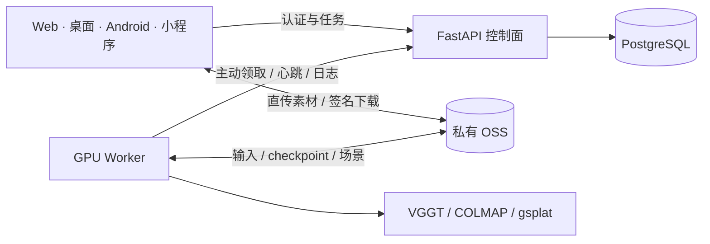

<p align="center">
  
</p>

<h1 align="center">ReScene</h1>

<p align="center">从图片与视频，到可浏览、下载和分享的 3D Gaussian Splatting 场景。</p>

<p align="center">
  <a href="https://rescene.xyz/">项目主页</a> ·
  <a href="https://app.rescene.xyz">在线工作台</a> ·
  <a href="https://github.com/FLmhp/ReScene/releases/tag/v0.5.0">下载 0.5.0</a> ·
  <a href="docs/用户手册.md">用户手册</a> ·
  <a href="CONTRIBUTING.md">开发指南</a>
</p>

ReScene 把团队工作台、GPU 重建引擎和 SPZ 查看器放在同一个仓库中。用户上传素材、选择重建路线，Worker 完成几何估计与 Gaussian 优化，再将场景、指标和报告交付到对象存储。

[快速开始](#快速开始) · [系统架构](#系统架构) · [本地开发](#本地开发) · [重建路线](#重建路线) · [文档导航](#文档导航)

## 能做什么

- 图片或视频重建：FAST、BALANCED、QUALITY 三条路线，支持排队、取消、阶段恢复和运行日志。
- 团队协作：项目角色、邮箱邀请、自助注册与改密、通知、管理员用户治理、公告与审计导出。
- 场景交付：WebGL 浏览 PLY/SPZ、签名下载、限时分享、二维码与分享撤销。
- 多端访问：响应式 Web、Tauri 桌面、Expo Android 和 Taro 微信小程序；共享类型、API 客户端与上传逻辑。

<details>
<summary>历史界面截图</summary>

[Web 管理控制台历史验收截图](https://github.com/FLmhp/ReScene/blob/f999157c9ff04df1f33e820f7bd6742444ae6e92/artifacts/screenshots/web-admin-console.png)（需要仓库权限）

截图来自本地验收，不代表生产环境的实时状态。其他客户端与 Viewer 截图见 [验收证据](artifacts/README.md)。

0.4.1 候选版的 Windows 结果页采用独立下载列表，SHA-256 和分享撤销记录按需展开。 [Windows 真机截图](https://github.com/FLmhp/ReScene/blob/f999157c9ff04df1f33e820f7bd6742444ae6e92/artifacts/test-runs/2026-11-20-release-041/screenshots/windows-native-result-layout.png)

</details>

## 快速开始

直接使用 [在线工作台](https://app.rescene.xyz)，通过邮箱注册或登录，创建项目、上传素材，再选择路线开始重建。具体操作见 [用户手册](docs/用户手册.md)。Worker 离线时任务会排队，网页可用不等于 GPU 可执行任务。

[0.5.0 安装包](https://github.com/FLmhp/ReScene/releases/tag/v0.5.0)已通过下载校验和 Windows、Android 覆盖安装验证。官网、生产工作台及 API 均已升级到 **0.5.0**，数据库保持 `0010`。公网工作台已实测登录和历史场景浏览；GPU Worker 离线，未做训练回归。微信只上传了开发版。 [0.5.0 发布说明](docs/0.5.0发布说明.md) · [0.4.1 上线记录](plans/README.md#041-审计集成补验)

| 入口 | 0.4.1 历史验收 |
|---|---|
| Web / API | 2026-11-21 停写迁移后上线，API `0.4.1`；数据库 `0010`（上线时为 `0009`，后续审计部署升级），公网入口与管理员读取验证通过 |
| Windows | 候选已实测从 0.4.0 覆盖安装、结果页布局、SPZ 渲染、五种产物下载和分享撤销；正式包仍为 0.4.0 |
| Android | 0.4.1 真机 HUAWEI BKY-W10 / Android 12 验证登录、冷启动会话、真实 OSS 上传、生产重建、日志轮询和 Viewer 首载渲染；Android 35 模拟器另覆盖 403 续签、503 重试、离线重放与换号隔离。正式签名包仍为 0.4.0。 [真机报告](https://github.com/FLmhp/ReScene/blob/f999157c9ff04df1f33e820f7bd6742444ae6e92/artifacts/test-runs/2026-11-21-android-device/report.md) |
| 微信小程序 | 开发者工具验证登录页渲染和编译构建；真机日志追踪与分享切换待验收，正式版以平台审核为准 |

0.4.1 上线时，生产 Worker 完成真实重建并交付了 SPZ、PLY、指标和报告。此前候选的六条 GPU 路线、checkpoint 恢复、取消与上传边界在隔离环境中复验；这些记录不是 0.5.0 的训练结果。 [0.4.1 品牌与真机验收](https://github.com/FLmhp/ReScene/blob/f999157c9ff04df1f33e820f7bd6742444ae6e92/artifacts/test-runs/2026-11-20-brand-refresh/report.md)

0.4.1 候选采用青色 R 与蓝紫色 S 组成的新标志。技术设计和中期报告的现状附录见 [Word 文档索引](docs/reference/README.md)。 [项目官网](https://rescene.xyz/)

> [!IMPORTANT]
> 仓库与 GitHub Release 已公开，安装包可直接下载。桌面安装包未签名，macOS 未公证；构建成功不等于各平台安装验收完成。安装包、校验值与验收设备见 [0.5.1 发布说明](docs/0.5.1发布说明.md)。

界面提供跟随系统、浅色和深色设置，另有青瓷素影、群青远山、墨染松烟、胭脂海棠、朱砂落印、赭石秋峦、靛青夜泊七套传统配色和自定主色，配色以圆角色块预览主色调；未保存过偏好的设备默认跟随系统并使用群青远山，两项偏好分别保存在当前设备。Web/桌面在外观菜单中切换，Android/小程序在页面右上角切换。半透明面板只在平台支持时启用，其余环境使用实色。开发者入口见 [AGENTS.md](AGENTS.md)。

## 系统架构



公网服务器运行 Caddy、Next.js、FastAPI 和 PostgreSQL；GPU Worker 独立运行，不开放入站端口，单 GPU 任务并发为 1。素材与重建产物不经 Web/API 服务器中转。

| 目录 | 职责 |
|---|---|
| `apps/` | 独立静态官网、Web 工作台、桌面、Android、小程序入口 |
| `packages/` | 契约、API 客户端、上传器、查看器、工作台与设计变量 |
| `src/rescene/` | 预处理、几何、3DGS 优化、评测与导出 |
| `src/rescene_api/` · `src/rescene_worker/` | 控制面与 GPU 任务执行 |
| `infra/` · `scripts/` | 部署、备份、Worker 管理、构建与发布 |
| `configs/` · `calibration/` | 实验配置与标定记录 |
| `docs/` · `artifacts/` | 使用文档与可复核证据，不存放安装包、权重或场景二进制 |

## 本地开发

基础环境：**Python 3.11、uv、Node.js 22、pnpm 10.18.3**。下面的 API 与 Web 启动不需要 GPU；桌面原生壳、Android 和 GPU 引擎另有工具链要求，见 [开发指南](CONTRIBUTING.md)。所有命令从仓库根目录执行。

### 1. 安装依赖

Windows PowerShell：

```powershell
py -3.11 -m venv .venv
uv pip install --python .venv/Scripts/python.exe -c infra/api/constraints.txt -e ".[dev,api,worker]" scipy
pnpm install --frozen-lockfile
git config core.hooksPath .githooks
```

<details>
<summary>Linux / macOS</summary>

```bash
python3.11 -m venv .venv
uv pip install --python .venv/bin/python -c infra/api/constraints.txt -e '.[dev,api,worker]' scipy
pnpm install --frozen-lockfile
git config core.hooksPath .githooks
```

</details>

### 2. 启动 API

使用本地 SQLite，数据放在已忽略的缓存目录；启动时自动执行迁移。

```powershell
New-Item -ItemType Directory -Force .cache/dev | Out-Null
$env:RESCENE_DATABASE_URL = "sqlite:///.cache/dev/rescene.db"
$env:RESCENE_PUBLIC_WEB_URL = "http://localhost:3000"
.venv/Scripts/python.exe -m uvicorn rescene_api.main:app --host 127.0.0.1 --port 8000 --reload
```

<details>
<summary>Linux / macOS</summary>

```bash
mkdir -p .cache/dev
export RESCENE_DATABASE_URL=sqlite:///.cache/dev/rescene.db
export RESCENE_PUBLIC_WEB_URL=http://localhost:3000
.venv/bin/python -m uvicorn rescene_api.main:app --host 127.0.0.1 --port 8000 --reload
```

</details>

### 3. 启动 Web

另开终端：

```bash
pnpm --filter rescene-web dev
```

打开 <http://localhost:3000>，注册本地账号。API 文档在 <http://localhost:8000/docs>，就绪检查在 <http://localhost:8000/health/ready>。开发态 Web 默认连接本地 API，无需填写生产凭据。

> [!NOTE]
> 该环境可用于账号、项目和界面开发；真实上传需要配置 OSS/RAM，重建还需要 GPU Worker、CUDA 与模型权重。默认开发密钥不得用于公网部署，也不要把本地客户端接到生产环境做日常测试。

### 4. 验证改动

```powershell
.venv/Scripts/python.exe -m pytest -q
pnpm check:versions
pnpm -r typecheck
pnpm -r test
```

日常按改动范围运行最小验证。完整质量命令、五个 CI 门禁、契约修改顺序和发布检查表见 [开发与发布指南](CONTRIBUTING.md)。`pnpm quality` 不包含原生安装包、四端构建或 Docker 镜像构建；CI 通过也不代表 GPU 质量回归通过。

### 5. Android 调试（可选）

Android 的 API 与 Web 地址在打包时内联。未设置 `EXPO_PUBLIC_API_URL` 和 `EXPO_PUBLIC_WEB_URL` 时会回退到生产地址，开发构建也一样。复制 `apps/mobile/.env.example` 为 `apps/mobile/.env.local`：模拟器用 `http://10.0.2.2:8000` 和 `http://10.0.2.2:3000`，真机改用主机的局域网 IP 和同样端口，然后运行 `pnpm --filter @rescene/mobile start`。账号页会显示当前服务器地址；详细配置、端口绑定和确认方法见[开发指南](CONTRIBUTING.md#android-开发环境)。

## 重建路线

| Profile | 几何路线 | 默认 Gaussian 优化步数 | 最大输入帧数 |
|---|---|---:|---:|
| `fast` | VGGT | 7,000 | 80 |
| `balanced`（默认） | VGGT + Bundle Adjustment | 20,000 | 80 |
| `quality` | COLMAP SfM / BA / MVS | 20,000 | 250 |

VGGT 使用预训练权重推理；这里的“训练”指每个场景的 Gaussian 优化。默认 VGGT-1B 权重受其学术非商用许可约束，不能把本项目可运行等同于允许商业使用。

GPU 环境准备好后，可通过 CLI 独立运行：

```bash
python -m rescene --help
python -m rescene run --profile balanced --input ./data/my-scene --run-id my-scene --resume
python -m rescene report --run-id my-scene
```

引擎环境与 Worker 操作见 [部署与运维](docs/单5090系统部署与运维.md)；质量结论见 [5090 v3 优化报告](docs/RESCENE_5090_DELIVERY_OPTIMIZATION.md)。历史标定存在冻结帧、渲染分割和坐标变换口径问题，不能直接作为新候选的晋级基线。

5090 已完成图片与视频各三条路线的交付回归。六条任务的 checkpoint、PLY 和 SPZ 均可重载，隔离断联测试验证了 OSS 阶段恢复。ETH3D 四个 DSLR 场景的 FAST 分网格采点都达到 8/8 张验证图稀疏支持，该策略继续通过实验规格启用。BALANCED 候选跳过参数相同的 BA 重试，QUALITY 仍使用 5 次 PatchMatch。 [0.4.1 GPU 验收](https://github.com/FLmhp/ReScene/blob/f999157c9ff04df1f33e820f7bd6742444ae6e92/artifacts/test-runs/2026-11-20-release-041/report.md#5090-路线) · [ETH3D 独立场景实验](https://github.com/FLmhp/ReScene/blob/f999157c9ff04df1f33e820f7bd6742444ae6e92/artifacts/test-runs/2026-11-19-5090-independent-optimization/report.md)

后续 5090 实验将归档保存在 `/root/autodl-fs`，每次在实例本地数据盘展开一个场景，按相同冻结输入比较端到端耗时、质量和完整进程树显存。 [5090 大数据集训练运行手册](docs/5090大数据集训练运行手册.md)

### 后续 A100 优化

1. 在独立 `/home/loch/ReScene` 环境固定数据 SHA-256、选帧清单、验证集和依赖。先用 Golden Kitchen 和 ETH3D 复测三条现有路线，各重复三次，记录运行波动。
2. FAST 逐项比较迭代数和训练分辨率；BALANCED 比较跟踪与 BA 参数；QUALITY 比较相机模型与 MVS 分辨率。每次只改变一项，用同一输入和验证集记录注册率、重投影误差、PSNR、SSIM、LPIPS、几何指标、耗时和峰值显存。
3. 用独立场景复核候选，保留质量和稳定性无回归且有明确收益的配置。发布配置前校验 checkpoint、PLY 和 SPZ 可重载。A100 实验配置与生产 5090 配置独立管理。

## 文档导航

| 我想…… | 入口 |
|---|---|
| 使用工作台、查看场景或管理账号 | [用户手册](docs/用户手册.md) |
| 理解 API、数据模型和各端实现 | [项目说明](docs/项目说明.md) |
| 修改代码、提交 PR、验证或发布 | [开发与发布指南](CONTRIBUTING.md) |
| 下载并核对当前安装包 | [0.5.0 发布说明](docs/0.5.0发布说明.md) |
| 查看历史安装包 | [0.4.0 发布说明](docs/0.4.0发布说明.md) |
| 了解候选版与上线门槛 | [0.4.1 验收报告](https://github.com/FLmhp/ReScene/blob/f999157c9ff04df1f33e820f7bd6742444ae6e92/artifacts/test-runs/2026-11-20-release-041/report.md) |
| 部署、升级、备份或回滚 | [单 5090 系统部署与运维](docs/单5090系统部署与运维.md) |
| 查看截图、样例指标和发布哈希 | [验收与发布证据](artifacts/README.md) |
| 复核算法实验 | [5090 v3](docs/RESCENE_5090_DELIVERY_OPTIMIZATION.md) · [质量标定](docs/5090_QUALITY_CALIBRATION.md) · [A100 历史报告](docs/A100_OPTIMIZATION_REPORT.md) |
