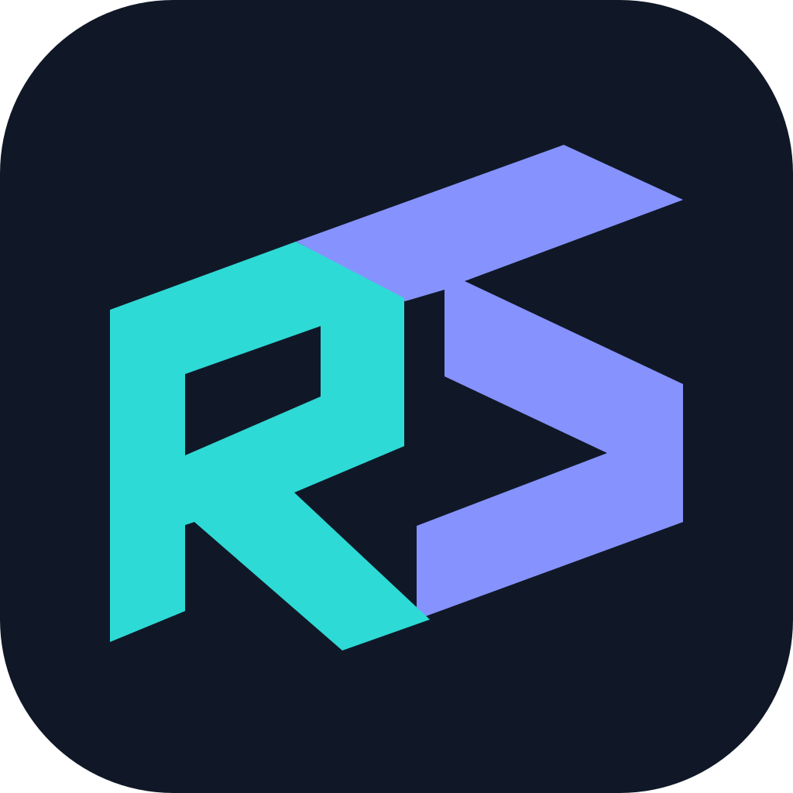
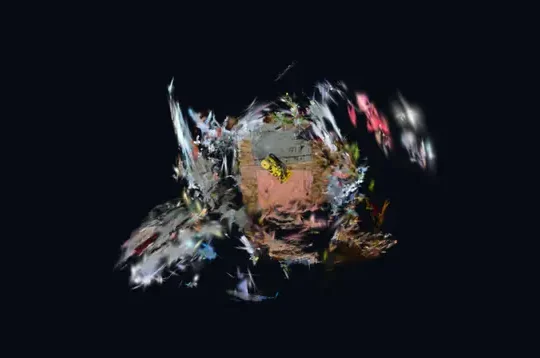

<p align="center">
  
</p>

<h1 align="center">ReScene</h1>

<p align="center">把照片与视频，变成可浏览、可导出、可分享的 3D Gaussian Splatting 场景。</p>

<p align="center">
  <a href="README.md" hreflang="en" lang="en">English</a> ·
  <span lang="zh-CN">简体中文</span>
</p>

<p align="center">
  <a href="https://github.com/FLmhp/ReScene/actions/workflows/check.yml"></a>
  <a href="https://github.com/FLmhp/ReScene/releases"></a>
  <a href="LICENSE"></a>
</p>

<p align="center">
  <a href="https://rescene.xyz/">项目官网</a> ·
  <a href="https://app.rescene.xyz/">在线工作台</a> ·
  <a href="https://github.com/FLmhp/ReScene/releases">下载</a>
</p>

## 概览与适用场景

ReScene 在一个仓库里包含完整的重建闭环：工作台（Web、Tauri 桌面、Expo Android、Taro 微信小程序）、FastAPI 控制面与 PostgreSQL 租约队列、把素材和产物存放在私有 OSS 的 GPU Worker，以及运行 VGGT、COLMAP 和 gsplat 的 Python 引擎。

当你围绕一个静态场景或物体拍摄一组有重叠的照片、或一段连续视频，并希望得到可浏览、可下载、可转交他人的 splat，而不是自行拼装几何流水线、任务队列、项目权限和签名产物交付时，它适合你。

它不是测量或 CAD 工具；这里不对吞吐或重建精度作任何承诺，结果取决于拍摄、路线与硬件。

## 为什么选 ReScene

工作台把通常分散在多个工具里的步骤串在一起。下面每一步都对应 `src/rescene_api` 与 `src/rescene_worker` 中已实现的路由：

1. **上传。** 照片或视频通过上传会话从客户端直传私有 OSS（`/v1/projects/{project_id}/assets/upload-session`，随后 `/v1/assets/{asset_id}/complete`），素材不经过 API 服务器中转。
2. **排队。** 选定路线创建任务（`POST /v1/projects/{project_id}/jobs`）后进入 PostgreSQL 租约队列；GPU Worker 领取任务、发送心跳，并上报各阶段进度与日志。
3. **跟踪与恢复。** 可读取任务状态、阶段历史与日志（`/v1/jobs/{job_id}`、`/v1/jobs/{job_id}/stages`、`/v1/jobs/{job_id}/logs`）；任务可取消或重试，Worker 断联后从已记录阶段继续。
4. **查看。** Viewer 在浏览器中用 WebGL 渲染 PLY 与 SPZ。
5. **交付。** 重建清单（`/v1/reconstructions/{reconstruction_id}/manifest`）返回各产物的签名 URL、大小与 SHA-256，其中包括 SPZ 和 PLY 场景文件。
6. **分享。** 分享（`POST /v1/reconstructions/{reconstruction_id}/shares`）是带有效期的令牌；撤销（`DELETE /v1/shares/{share_id}`）前，公开链接及其二维码可访问。

与它所依赖的工具相比，优势在于工作流整合，而不是速度或质量：

| | 覆盖范围 | 仍需自行搭建 |
|---|---|---|
| [COLMAP](https://colmap.github.io/) | 运动恢复结构（SfM）与多视图立体（MVS），自带 GUI 和 CLI | 排队、项目状态、权限、查看器、交付与分享 |
| [Nerfstudio Splatfacto](https://docs.nerf.studio/nerfology/methods/splat.html) | Gaussian Splatting 训练、查看器与 PLY 导出 | 团队化使用：账号、项目状态、GPU 任务队列、签名交付、可撤销链接 |
| ReScene | 在 VGGT、COLMAP 与 gsplat 之上，把选线、排队、项目状态、查看器、SPZ/PLY 交付与可撤销分享放进同一工作流 | OSS、CUDA GPU 与自有模型权重 |

COLMAP 和 Splatfacto 都是自带查看器与导出能力的成熟引擎；ReScene 封装这些引擎，不声称在质量上超过它们。

## 路线和客户端

路线定义来自 `src/rescene/config.py::PROFILES`：

| 路线 | 几何 | 场景优化步数 | 最大输入帧数 | 说明 |
|---|---|---:|---:|---|
| `FAST` | VGGT | 7,000 | 80 | 不做 Bundle Adjustment |
| `BALANCED`（默认） | VGGT + Bundle Adjustment | 20,000 | 80 | 不做稠密重建 |
| `QUALITY` | COLMAP SfM / BA / MVS | 20,000 | 250 | 包含 COLMAP 稠密重建 |

步数是每个场景的 Gaussian 优化步数，不是重新训练 VGGT：VGGT 只做预训练权重推理。

| 客户端 | 当前状态 |
|---|---|
| Web 工作台 | <https://app.rescene.xyz/>，线上已部署当前发布版 |
| Windows | [Releases](https://github.com/FLmhp/ReScene/releases) 中的 `ReScene_0.5.1_x64-setup.exe`；CI 构建，未做代码签名，未记录本机安装实测 |
| Linux | Releases 中的 `ReScene_0.5.1_amd64.deb` 与 `ReScene_0.5.1_amd64.AppImage`；CI 构建，未记录安装实测 |
| macOS | Releases 中的 `ReScene_0.5.1_universal.dmg`；CI 构建，未签名、未公证 |
| Android | Releases 中的 `app-release.apk`；已用发布 keystore 签名，不通过应用商店分发 |
| 微信小程序 | 仅源码与开发版构建，未发布到微信商店 |

项目协作采用邀请制：邀请方签发一枚绑定受邀邮箱的一次性领取码，再自行转交给对方。ReScene 不发送邀请邮件。

<p align="center">
  
  <br>
  <sub>实际 ReScene 界面中的场景样张——不是实时输出，也不是本轮基准测试结果。</sub>
</p>

## 本地开始

基础环境：Python 3.11、[uv](https://docs.astral.sh/uv/)、Node.js 22 与 pnpm 10.18.3。API 与 Web 工作台可在 CPU + SQLite 上本地运行；官网预览只需要 Node。

Windows PowerShell：

```powershell
py -3.11 -m venv .venv
uv pip install --python .venv/Scripts/python.exe -c infra/api/constraints.txt -e ".[dev,api,worker]" scipy
pnpm install --frozen-lockfile
```

Linux / macOS：

```bash
python3.11 -m venv .venv
uv pip install --python .venv/bin/python -c infra/api/constraints.txt -e '.[dev,api,worker]' scipy
pnpm install --frozen-lockfile
```

用本地 SQLite 启动 API（启动时自动执行迁移）：

```powershell
New-Item -ItemType Directory -Force .cache/dev | Out-Null
$env:RESCENE_DATABASE_URL = "sqlite:///.cache/dev/rescene.db"
$env:RESCENE_PUBLIC_WEB_URL = "http://localhost:3000"
.venv/Scripts/python.exe -m uvicorn rescene_api.main:app --host 127.0.0.1 --port 8000 --reload
```

Linux / macOS 改用 `mkdir -p .cache/dev`、`export RESCENE_DATABASE_URL=sqlite:///.cache/dev/rescene.db`、`export RESCENE_PUBLIC_WEB_URL=http://localhost:3000` 与 `.venv/bin/python -m uvicorn rescene_api.main:app --host 127.0.0.1 --port 8000 --reload`。

再另开终端：

```bash
pnpm --filter rescene-web dev   # 工作台 http://localhost:3000
pnpm --filter @rescene/site dev # 静态官网 http://127.0.0.1:4320
```

真实上传需要配置 OSS/RAM，真实重建还需要带模型权重的 CUDA GPU Worker；Worker 离线时任务继续排队。开发默认密钥仅限本机回环使用。桌面原生、Android、小程序与发布命令见 [CONTRIBUTING.md](CONTRIBUTING.md)。

## 文档与许可

| 我想…… | 入口 |
|---|---|
| 使用工作台、查看场景、管理账号 | [用户手册](docs/用户手册.md) |
| 理解 API、数据模型与各端实现 | [项目说明](docs/项目说明.md) |
| 修改代码、提交 PR、验证或发布 | [开发与发布指南](CONTRIBUTING.md) |
| 部署、升级、备份或回滚 | [部署与运维](docs/单5090系统部署与运维.md) |
| 核对当前发布的内容 | [0.5.1 发布说明](docs/0.5.1发布说明.md) |

具体构建的部署验收细节写在该版本的发布说明里，不写进本文件。

项目自有源代码与文档采用 [MIT 许可](LICENSE)，版权 © 2026 ReScene contributors。该许可不覆盖项目运行时可能涉及的全部内容：

- **VGGT-1B 权重** — [facebook/VGGT-1B](https://huggingface.co/facebook/VGGT-1B) 为 CC BY-NC 4.0（非商用）。运行 FAST 与 BALANCED 路线不代表获得这些权重的商用权利。
- **Inter 字体** — SIL Open Font License 1.1，见 [Inter-LICENSE.txt](packages/design-tokens/assets/Inter-LICENSE.txt)。
- **ETH3D 数据** — 实验中所用数据受 ETH3D 数据集条款约束，见 <https://www.eth3d.net/>。
- **plyfile** — [GPLv3](https://pypi.org/project/plyfile/)，Python 引擎的运行时依赖。

容器镜像、模型权重、数据集以及完整依赖组合不按 MIT 重新授权；再分发或商业使用前请逐个核对各组件的自身条款。
