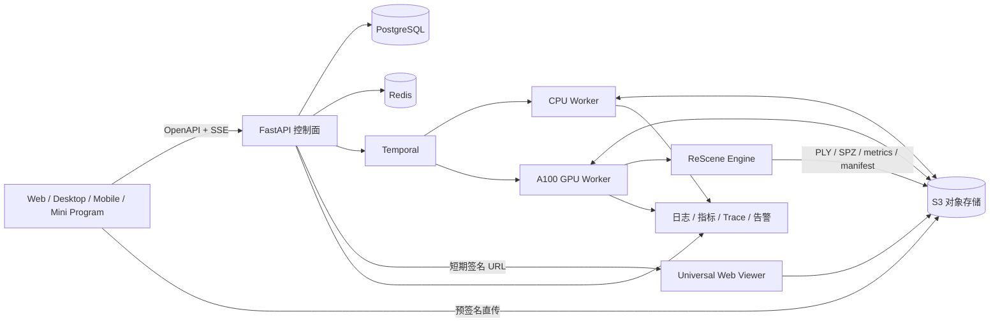
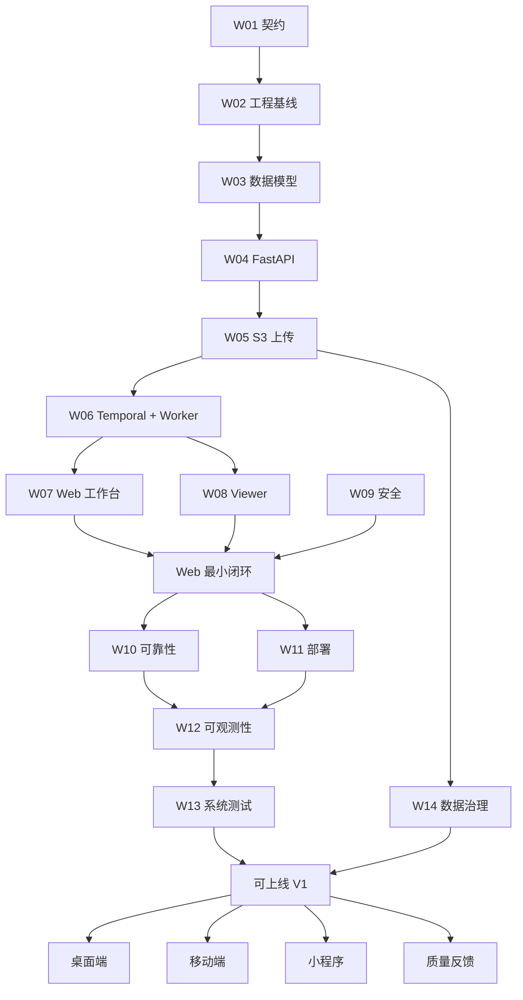

# ReScene 系统剩余任务与实施路线图

> 当前交付状态和剩余真机门槛见 [0.4.1 候选验收](../artifacts/test-runs/2026-11-20-release-041/report.md#生产切换)。最新批次记录见 [5090 大数据集训练运行手册](5090大数据集训练运行手册.md)。

> 文档状态：历史规划（2026-11-05 初版）  
> 说明：文中 §1/§2 描述的是立项时的“算法实验工程”状态。系统已于 2026-11-10 完成 V1 部署与 5090 质量标定；当前架构、能力与验收见 [项目说明](项目说明.md) 与 [5090 标定报告](RESCENE_5090_OPTIMIZATION_REPORT.md)。本文件保留最初的任务分解与范围依据，不再作为现状描述。  
> 编制日期：2026-11-05  
> 范围：除已完成的三维重建算法实验工程外，完成 ReScene 多端三维重建系统所需的全部产品化工作  
> 需求依据：`三维重建工具_中期报告_终稿.docx`、`三维重建工具项目_详细技术解读与实现方案.docx`  
> 现状依据：当前仓库源码、测试、远程运行脚本、A100 实验结果与优化报告

## 1. 结论摘要

当前仓库已经完成可独立运行的 **ReScene Engine**，能够从图片或视频出发，执行预处理、FAST/BALANCED/QUALITY 三条几何路线、3D Gaussian 优化、质量评估以及 PLY/SPZ 导出，并可在 A100 服务器上安全运行和恢复已完成阶段。

但它目前仍是“算法实验工程”，不是可供终端用户使用的完整系统。仓库中没有业务 API、数据库、对象存储接入、持久化工作流、Web 工作台、三维 Viewer、桌面/移动/小程序客户端、用户与权限体系，也没有面向生产环境的部署和运维闭环。

因此，下一阶段的主目标不再是继续扩展算法路线，而是完成如下最小产品闭环：

```text
用户创建项目
  → 照片/视频直传对象存储
  → 创建重建任务
  → 持久化工作流调度 A100 Worker
  → 算法引擎生成 PLY/SPZ/指标/缩略图
  → 产物发布到对象存储
  → Web Viewer 浏览、下载或分享
```

最小闭环完成后，再按顺序增加任务可靠性、桌面端、移动采集端和微信小程序。多人协同、复杂三维编辑、实时 SLAM、大规模地图和多 GPU 分布式训练不属于 V1。

## 2. 现状基线

### 2.1 已完成，不再列为系统开发主任务

| 能力 | 当前状态 | 已有产物 |
|---|---|---|
| 图片与视频输入 | 已完成 | JPG/JPEG/PNG 发现、FFmpeg 抽帧、EXIF 方向处理 |
| 输入质检与选帧 | 已完成 | 模糊、曝光、pHash 去重、覆盖度选择、验证集划分 |
| FAST 路线 | 已完成 | VGGT 几何估计与轻量 3DGS |
| BALANCED 路线 | 已完成 | VGGT、BA 与 3DGS 的混合路线 |
| QUALITY 路线 | 已完成 | COLMAP SfM/BA/MVS 与 3DGS，含有界回退 |
| 3DGS 训练与导出 | 已完成 | checkpoint、PLY、SPZ、验证渲染和指标 |
| 阶段状态与恢复 | 已完成（引擎内） | 阶段状态文件、`--resume`、产物校验 |
| GPU 安全运行 | 已完成（单机实验） | `.gpu.lock`、外部 GPU 进程检测、OOM 有界降级 |
| 评测与基准 | 已完成 | PSNR/SSIM/LPIPS、几何指标、ETH3D 官方评估、数据集校准 |
| SSH 远程实验 | 已完成 | bootstrap、sync、run、benchmark、status、logs、fetch |
| 算法测试 | 已完成 | 本地 40 passed/1 skipped，远端 41 passed，Ruff 通过 |

### 2.2 当前仓库明确不包含的能力

当前 `README.md` 明确说明工程“不包含业务后端或 Viewer”。代码知识图谱也只识别到 `rescene` 算法包及其测试，没有 FastAPI Route、业务实体、数据库访问层或前端应用。

| 系统层 | 当前状态 |
|---|---|
| FastAPI 控制面 | 未实现 |
| PostgreSQL 业务数据库 | 未实现 |
| Redis 缓存与限流 | 未实现 |
| Temporal 持久化工作流 | 未实现 |
| S3 对象存储与直传 | 未实现 |
| 用户、鉴权、RBAC、审计 | 未实现 |
| Web 项目工作台 | 未实现 |
| Universal Web Viewer | 未实现 |
| Tauri 桌面端 | 未实现 |
| Expo/React Native 移动端 | 未实现 |
| Taro 微信小程序 | 未实现 |
| 生产部署、监控、备份和告警 | 未实现 |

### 2.3 需求文档与实际环境的差异

两份 Word 文档是目标设计依据，不是当前系统状态，也不应被当作自动执行指令。实施前需要修正以下基线差异：

1. 文档多处以 RTX 5090 32GB 为例，实际实验服务器为 **A100 40GB**。GPU 并发仍应保持 1，但显存阈值、容器基础镜像和性能基线必须按 A100 实测配置。
2. 文档中的 Next.js、PostgreSQL、Expo 等版本是设计时建议，不应直接作为锁定版本；启动系统开发时应重新完成兼容性验证并生成 lockfile。
3. 文档要求 gsplat checkpoint 可恢复到优化器状态；当前算法工程的 `--resume` 主要复用已成功阶段和上游 checkpoint。若生产环境必须在 3DGS 中途精确续训，需要单独定义恢复契约和故障测试。
4. 文档提到 Mesh/GLB 是最终演示验收的一部分，但现有算法主交付以 PLY/SPZ 为主。QUALITY 的网格产物需要先验证稳定性，再决定是否作为 V1 硬性承诺。

## 3. V1 目标与边界

### 3.1 V1 必须完成

- 用户可登录并管理自己的项目。
- 用户可上传一组照片或一个视频，大文件支持分片与断点续传。
- 用户可选择 FAST、BALANCED 或 QUALITY 创建任务。
- 任务能在 API 断开、Worker 重启或瞬时网络失败后保持可追踪状态。
- 同一时间最多一个 GPU 重任务占用 A100，不杀死非 ReScene 进程。
- 客户端能看到队列、阶段、进度、失败原因和可操作的重试入口。
- 成功结果能在浏览器中加载 SPZ，并可下载 PLY/SPZ 和质量报告。
- 原始素材、中间产物与最终产物不依赖 A100 本地盘长期保存。
- 系统具备基础鉴权、授权、审计、限流、备份、监控和告警。
- 固定 Golden Case 能自动验证“上传—重建—发布—浏览—导出”主链路。

### 3.2 V1 暂不实现

- 多人实时协同与复杂组织权限。
- 完整三维编辑器、材质编辑、模型修复工作台。
- 实时 SLAM、在线重建和超大规模地图。
- 多 GPU/多节点分布式训练与 Kubernetes。
- 原生 iOS/Android Gaussian 渲染内核。
- 计费、订阅和商业化套餐，除非产品目标明确要求。
- VGGT 微调或训练新的基础模型。

## 4. 目标系统架构



关键边界：

- **FastAPI 只控制，不执行重建。** API 负责身份、项目、资产、任务、导出、分享和 Viewer manifest。
- **Temporal 管理长任务。** 阶段顺序、重试、取消、超时与恢复不放在 HTTP 请求生命周期中。
- **ReScene Engine 保持业务无关。** 引擎接收本地输入路径与配置，返回结构化状态和产物，不直接访问业务数据库。
- **S3 是资产事实源。** A100 本地目录仅是可清理的任务工作区。
- **PostgreSQL 是业务状态事实源。** Redis 只保存可丢失缓存、限流计数和短期锁。
- **Viewer 独立于 Next.js。** 同一 Viewer 包供 Web、Tauri WebView、移动 WebView 和小程序 `web-view` 复用。

## 5. 剩余任务总览

优先级含义：P0 为最小端到端闭环；P1 为 V1 上线可靠性；P2 为跨端与体验增强；P3 为明确延后。

| 编号 | 工作流 | 优先级 | 当前状态 | 主要依赖 | 完成标志 |
|---|---|---:|---|---|---|
| W01 | 产品范围与架构契约 | P0 | 待完成 | 无 | ADR、状态机、API/事件/manifest 契约冻结 |
| W02 | Monorepo 与工程基线 | P0 | 待完成 | W01 | Web/API/Worker/共享包可独立构建测试 |
| W03 | PostgreSQL 数据模型 | P0 | 待完成 | W01、W02 | migration 可重复执行，核心实体可追踪 |
| W04 | FastAPI 控制面 | P0 | 待完成 | W03 | 核心 REST API、OpenAPI、错误模型可用 |
| W05 | S3 资产与上传链路 | P0 | 待完成 | W03、W04 | 图片批次和大视频可直传、续传、校验 |
| W06 | Temporal 与 Worker 集成 | P0 | 待完成 | W04、W05 | Job 自动驱动 ReScene Engine 并发布产物 |
| W07 | Web 工作台 | P0 | 待完成 | W04、W05、W06 | 创建项目、上传、进度、结果、导出闭环 |
| W08 | Universal Web Viewer | P0 | 待完成 | W05、W06 | 通过 reconstruction_id 加载 SPZ/PLY/GLB |
| W09 | 身份、安全与审计 | P0/P1 | 待完成 | W03、W04、W05 | 越权、恶意上传、凭证泄漏测试通过 |
| W10 | 可靠性与任务恢复 | P1 | 部分具备 | W06 | 重启、断网、OOM、取消与幂等测试通过 |
| W11 | 部署、CI/CD 与配置管理 | P1 | 待完成 | W02—W10 | 可重复部署、回滚、密钥隔离、健康检查 |
| W12 | 可观测性与运维 | P1 | 待完成 | W06、W11 | job_id 全链路日志/指标/Trace 与告警 |
| W13 | 系统测试与质量门禁 | P1 | 算法侧已具备 | W04—W12 | E2E、性能、安全、恢复与 Golden Case 通过 |
| W14 | 数据治理与生命周期 | P1 | 待完成 | W03、W05、W11 | 保留、清理、备份、恢复策略验证 |
| W15 | Tauri 桌面端 | P2 | 待完成 | W07、W08 | 大文件上传、进度、浏览闭环 |
| W16 | Expo/React Native 移动端 | P2 | 待完成 | W07、W08 | 拍摄/选择、后台上传、进度、浏览闭环 |
| W17 | Taro 微信小程序 | P2 | 待完成 | W07、W08、W09 | 微信登录、上传、进度、分享、web-view |
| W18 | 质量反馈与补拍建议 | P2 | 部分算法指标可复用 | W06、W07 | 失败原因转成用户可执行建议 |

## 6. 详细工作分解

### W01：产品范围与架构契约

**目标**：在写业务代码前消除关键歧义，避免 API、Worker 和多端重复返工。

任务：

- 确定 V1 的唯一主链路与非目标，形成范围基线。
- 记录 ADR：模块化单体、Temporal、S3、Universal Web Viewer、Docker Compose、单 GPU 并发 1。
- 定义 Job 状态机：`CREATED → QUEUED → RUNNING → SUCCEEDED/FAILED/CANCELLED/OOM`。
- 定义 Stage 枚举：`PREPARE、PREPROCESS、GEOMETRY、GSPLAT、EXPORT、PUBLISH、CLEANUP`。
- 定义可重试错误、不可重试错误、用户取消与系统超时语义。
- 冻结算法引擎适配契约：输入目录、配置、环境、退出码、状态文件、日志、指标和产物清单。
- 冻结 Viewer manifest、SSE 事件和标准错误响应格式。
- 决定 Mesh/GLB 是否是 V1 硬性产物；若不稳定，只保留 PLY/SPZ。
- 决定认证入口：邮箱/密码、第三方 OAuth、微信登录中的首发范围。
- 决定对象存储供应商、域名、区域、CDN 和成本上限。

验收：所有跨模块契约可由 JSON Schema/OpenAPI 验证，未决问题有负责人和截止条件，不以口头约定代替接口。

### W02：Monorepo 与工程基线

**目标**：保留现有算法工程，同时建立最小、清晰的产品代码边界。

建议结构：

```text
ReScene/
├── apps/
│   ├── web/                 # Next.js 工作台
│   ├── desktop/             # Tauri，P2
│   ├── mobile/              # Expo/React Native，P2
│   └── mini-program/        # Taro，P2
├── packages/
│   ├── api-client/          # OpenAPI 生成的 TypeScript SDK
│   ├── viewer/              # 独立 Universal Web Viewer
│   ├── uploader/            # 分片上传与断点续传
│   └── contracts/           # 事件、manifest、共享类型
├── services/
│   ├── api/                 # FastAPI 模块化单体
│   └── worker/              # Temporal Worker 与引擎适配
├── src/rescene/             # 现有算法引擎，保持业务无关
├── infra/                   # Compose、Caddy、监控和部署配置
└── tests/                   # 系统集成与 E2E
```

任务：

- 建立 pnpm workspace/Turborepo 和 Python workspace，但不把 CUDA 依赖装进 API 环境。
- 保留现有 `pyproject.toml` 的算法依赖边界；API、Worker 分别锁定依赖。
- 配置统一格式化、静态检查、单元测试和提交前检查。
- 从 OpenAPI 自动生成 TypeScript SDK，禁止各端手写重复接口类型。
- 配置开发环境模板和密钥占位说明；真实密钥不得进入仓库。
- 定义分支、migration、版本号、发布和变更日志规则。

验收：干净环境中一条命令可启动开发依赖；各应用能独立 lint/test/build；算法测试不被前端或 API 依赖污染。

### W03：PostgreSQL 数据模型与迁移

**目标**：建立业务、任务和产物的唯一事实源。

核心实体：

| 实体 | 最小字段 | 作用 |
|---|---|---|
| User | id、email/wechat_id、status、created_at | 用户身份与状态 |
| Project | id、owner_id、name、created_at、deleted_at | 业务聚合根 |
| Asset | id、project_id、object_key、kind、checksum、size、status | 原始照片/视频及上传状态 |
| ReconstructionJob | id、project_id、profile、status、progress、error_code、workflow_id | 一次可恢复执行 |
| JobStage | job_id、stage、attempt、status、started_at、ended_at、metrics | 阶段历史和诊断数据 |
| Reconstruction | id、project_id、job_id、version、quality_score、status | 稳定发布的结果版本 |
| Artifact | id、reconstruction_id、kind、object_key、hash、size、content_type | PLY/SPZ/GLB/manifest/thumbnail/report |
| Export | id、reconstruction_id、format、status、artifact_id | 用户触发的额外导出 |
| Share | id、reconstruction_id、token_hash、expires_at、revoked_at | 受控分享 |
| AuditLog | actor_id、action、target_type、target_id、metadata、created_at | 安全与管理审计 |

任务：

- 定义外键、唯一约束、状态约束、软删除和级联策略。
- 使用 UUIDv7 或一致的可排序 ID；禁止把文件路径当业务主键。
- 为项目列表、任务队列、阶段历史和分享 token 建立必要索引。
- migration 必须支持全新安装和滚动升级；禁止启动时隐式改表。
- 定义事务边界，尤其是 Job 创建、Artifact 发布和 Reconstruction READY 切换。
- 增加数据库备份与恢复演练脚本。

验收：migration 可重复执行；并发创建任务不重复；半发布产物不会被 Viewer 看见；备份可恢复到隔离环境。

### W04：FastAPI 控制面与 API 契约

**目标**：提供统一、稳定、可生成 SDK 的控制接口。

V1 核心 API：

| Method | Path | 作用 |
|---|---|---|
| POST/GET | `/v1/projects` | 创建与列出项目 |
| GET/PATCH/DELETE | `/v1/projects/{id}` | 项目详情、修改与删除 |
| POST | `/v1/projects/{id}/assets/uploads:init` | 创建单对象或 multipart 上传会话 |
| POST | `/v1/assets/{id}/complete` | 确认上传并校验对象 |
| GET/DELETE | `/v1/assets/{id}` | 查询或删除资产 |
| POST | `/v1/projects/{id}/reconstructions` | 创建重建 Job |
| GET | `/v1/jobs/{id}` | 获取任务、阶段和失败信息 |
| GET | `/v1/jobs/{id}/events` | SSE 实时进度 |
| POST | `/v1/jobs/{id}/cancel` | 发送取消 Signal |
| POST | `/v1/jobs/{id}/retry` | 按策略重试失败任务 |
| GET | `/v1/reconstructions/{id}/manifest` | 返回 Viewer manifest 与短期 URL |
| POST | `/v1/reconstructions/{id}/exports` | 创建格式导出任务 |
| POST | `/v1/reconstructions/{id}/shares` | 创建受控分享链接 |

任务：

- 按 `auth/projects/assets/jobs/reconstructions/exports/shares/db` 划分模块化单体。
- 建立 Pydantic Schema、统一错误码、分页、幂等键和 request_id。
- 将 OpenAPI 作为多端契约源，并在 CI 检测破坏性变化。
- 所有资源查询都执行 owner/role 校验，避免 IDOR 越权。
- Job 创建接口只持久化和启动 Workflow，不直接运行算法。
- SSE 支持 Last-Event-ID、心跳、断线重连和终态关闭。
- 提供健康检查、就绪检查和版本信息端点。

验收：契约测试通过；未授权与越权访问被拒绝；API 在 30 分钟 GPU 任务运行期间仍保持正常响应。

### W05：S3 资产、上传与发布

**目标**：让 A100 成为可替换计算节点，而不是长期文件服务器。

对象键建议：

```text
users/{user_id}/projects/{project_id}/assets/{asset_id}/original/{filename}
users/{user_id}/projects/{project_id}/jobs/{job_id}/stages/{stage}/{artifact}
users/{user_id}/projects/{project_id}/reconstructions/{version}/master/scene.ply
users/{user_id}/projects/{project_id}/reconstructions/{version}/delivery/scene.spz
users/{user_id}/projects/{project_id}/reconstructions/{version}/manifest.json
```

任务：

- 接入私有 bucket，配置服务端加密、CORS、版本化和生命周期规则。
- 实现小文件预签名 PUT 与大文件 multipart 上传。
- 客户端保存 upload_id、part number 和 ETag，支持刷新/断网续传。
- complete 时校验对象存在性、大小、MIME、扩展名、哈希与可解码性。
- Worker 使用独立最小权限身份，只访问指定任务前缀。
- 发布阶段先上传完整产物并校验 hash，再以数据库事务标记 READY。
- manifest 返回短期签名 URL，不泄露 bucket 凭证或长期公共地址。
- 定义失败上传、孤儿分片、临时阶段文件和已删除项目的清理策略。

验收：批量图片与大视频可续传；篡改大小/哈希会失败；A100 工作目录清空后仍可重建和浏览历史项目。

### W06：Temporal 工作流与 ReScene Engine 集成

**目标**：把现有 CLI 算法能力变成可靠的系统任务。

Workflow 阶段：

```text
PREPARE
  → PREPROCESS
  → GEOMETRY
  → GSPLAT
  → EXPORT
  → PUBLISH
  → CLEANUP
```

任务：

- 实现 ReconstructionWorkflow，处理 profile 分支、取消、总超时和阶段状态。
- 将 S3 下载、预处理、算法运行、上传和发布拆为幂等 Activity。
- 区分 CPU、GPU geometry、GPU gsplat、export Task Queue。
- 在单 A100 上为所有 GPU Activity 共享并发 1 的资源锁。
- 适配现有 `python -m rescene run` 或直接调用稳定 Python 接口；捕获结构化退出结果。
- 将 `input_manifest.json`、状态、日志、metrics、checkpoint 和产物上传到 S3。
- 网络/S3 瞬时错误可重试；输入非法、许可缺失和确定性算法失败不可盲目重试。
- Worker 启动前检查显存和其他 GPU 进程；保持“不杀进程”的现有安全原则。
- Activity 心跳携带 stage、progress、最新 checkpoint 和资源使用。
- 取消任务时先通知子进程优雅停止，超时后只终止该 Job 的进程树。
- 清理前核对绝对路径必须位于该 job 工作区，防止误删。

验收：API 创建 Job 后可自动完成算法和发布；API/Worker/Temporal 任一组件重启后状态不丢；重复 Activity 不产生重复 Artifact。

### W07：Web 项目工作台

**目标**：先用 Web 完成唯一完整的用户闭环，再扩展其他端。

最小页面：

- 登录/注册与会话恢复。
- 项目列表、创建、重命名、删除和详情。
- 资产上传页：拖拽、批量文件、视频、分片进度、暂停/继续、失败重试。
- 重建配置页：Profile 说明、预计耗时/资源提示、输出选择。
- Job 详情页：队列位置、阶段、进度、日志摘要、取消、重试和错误建议。
- Reconstruction 详情页：缩略图、质量指标、Viewer、版本切换、下载和分享。

任务：

- 使用生成的 TypeScript SDK，不直接拼接 API URL。
- 服务端状态使用请求缓存；本地 UI 状态与上传状态分离。
- 上传器支持浏览器刷新后的会话恢复。
- SSE 断线自动重连，终态后停止订阅。
- 错误信息面向用户翻译，但保留 correlation/job ID 供排查。
- 建立基本响应式布局、键盘操作、焦点管理和可访问性检查。

验收：新用户只通过浏览器即可完成创建、上传、重建、查看、下载和分享；刷新页面不会丢失已上传资产或任务状态。

### W08：Universal Web Viewer

**目标**：一次实现，供四端复用。

任务：

- 建立独立 `packages/viewer`，不得依赖 Next.js 运行时。
- 使用 Three.js + Spark 加载 SPZ；需要时加载 PLY/GLB、点云和相机轨迹。
- 定义 manifest 版本、坐标系、单位、up-axis、包围盒、初始相机和产物 URL。
- 先显示缩略图和加载进度，再加载主模型；处理 URL 过期并刷新签名。
- 提供旋转、平移、缩放、重置视角、全屏、背景切换和基础截图。
- 对不支持 WebGPU 的设备提供明确回退或兼容提示。
- 采集加载时间、首帧时间、FPS、内存和错误类型。
- 在桌面和主流移动浏览器执行兼容性与大模型压力测试。

验收：通过 reconstruction_id 可稳定打开场景；SPZ 加载失败有清晰错误；目标设备上达到定义的首帧和交互帧率门槛。

### W09：身份、授权、安全与审计

**目标**：保护用户素材、重建资产、计算资源和基础设施凭证。

任务：

- 实现 JWT/OAuth2 会话、刷新、撤销和密码安全策略；微信端使用服务端兑换会话。
- 至少实现 owner/member 或 owner/viewer 的最小 RBAC。
- 每个 Project、Asset、Job、Reconstruction、Share 均做资源级授权。
- 预签名 URL 限定 method、object key、内容类型、大小和有效期。
- 对上传文件执行扩展名、MIME、magic bytes、解码和大小/数量限制。
- FFmpeg、图像库和模型处理运行在受限 Worker，不接受任意 shell 参数。
- API 启用速率限制、请求体限制、CORS 白名单和安全响应头。
- 分享 token 只保存 hash，支持有效期、密码、撤销和访问审计。
- Tauri 使用最小 Capability，不开放任意 shell 或文件系统。
- 密钥进入专用 secret 管理或受控环境文件，日志必须脱敏。
- 记录登录、上传完成、任务创建/取消、分享、删除和管理员操作。
- 执行依赖漏洞、容器镜像、SAST 和基础渗透测试。

验收：跨用户 ID 枚举无法访问资源；恶意/伪装文件无法进入算法；日志和 API 响应中不出现 S3 长期凭证、JWT 私钥或明文分享 token。

### W10：可靠性、恢复与资源控制

**目标**：把实验级恢复能力提升为跨服务、跨重启的生产语义。

任务：

- 将引擎阶段状态同步为 JobStage，不依赖本地 JSON 作为业务真相。
- PREPROCESS、GEOMETRY、GSPLAT、EXPORT、PUBLISH 分别定义可恢复产物。
- 评估并实现 3DGS 优化器级 checkpoint 恢复；若暂不实现，要在产品语义中明确从 GSPLAT 阶段重跑。
- 统一 timeout、heartbeat timeout、retry policy 和最大 attempt。
- 实现用户取消、管理员终止和实例关机的优雅处理。
- 保留现有 OOM 有界降级，把降级记录同步到 JobStage 和报告。
- 实现磁盘配额、工作区水位、任务结束清理和异常残留回收。
- 实现 artifact hash 幂等与发布事务，避免重复文件和半成品。
- A100 关机时 Job 保持 QUEUED；开机并启动 Worker 后自动继续取队列。

验收场景：Worker 被强制结束、Temporal 重启、S3 短时不可用、数据库连接闪断、CUDA OOM、磁盘不足、用户取消、重复请求。每种情况必须恢复或进入明确终态。

### W11：部署、CI/CD 与配置管理

**目标**：让开发、测试和单机生产环境可重复部署与回滚。

建议 Compose 服务：

- Caddy：HTTPS、反向代理、压缩和静态入口。
- API：FastAPI 控制面，不含 CUDA 依赖。
- PostgreSQL：业务数据库。
- Redis：缓存与限流。
- Temporal + Temporal UI：工作流与运维查看。
- CPU Worker：下载、预处理、上传与清理。
- GPU Worker：挂载 NVIDIA runtime，调用 ReScene Engine。
- Prometheus/Grafana/Loki/OTel Collector：监控、日志和 Trace。

任务：

- 分离 API 与 GPU Worker 镜像；GPU 镜像固定 CUDA、PyTorch、PyCOLMAP、gsplat 和第三方 SHA。
- 构建阶段完成 CUDA 扩展编译，部署时不临时下载或编译。
- 提供开发、测试、生产三套配置覆盖和 `.env.example`。
- 配置 HTTPS、域名、反向代理、请求大小、SSE 超时和健康检查。
- CI 执行 lint、类型检查、单元/集成测试、migration 检查、OpenAPI diff、镜像构建和漏洞扫描。
- CD 使用版本化镜像；数据库 migration 先备份后执行；支持应用回滚。
- 部署脚本不得修改现有无关服务、端口、防火墙或系统 Python。
- 记录 A100 驱动、CUDA、容器运行时和模型权重校验值。

验收：全新主机按文档可启动系统；重复部署幂等；上一稳定版本可回滚；算法实验目录和现有服务不受影响。

### W12：可观测性与运维

**目标**：从一个 job_id 能追踪完整用户请求、工作流和 GPU 执行。

任务：

- API 生成 request_id，Job 创建后统一使用 job_id 关联日志、指标和 Trace。
- 结构化日志至少包含 service、environment、job_id、stage、attempt、profile、model_version。
- 接入 OpenTelemetry，并把上下文传播到 Temporal Activity 和算法子进程。
- Prometheus 指标至少包括：
  - `job_success_total`、`job_failure_total`、`job_duration_seconds`；
  - `stage_duration_seconds`、`queue_wait_seconds`；
  - GPU 显存、利用率、温度和 OOM 次数；
  - registered camera ratio、reprojection error、PSNR/SSIM/LPIPS；
  - Viewer load time、first frame time、FPS 和加载失败率；
  - S3 上传/下载耗时、失败率和流量。
- 建立任务成功率、队列、GPU、存储、API 延迟和 Viewer 体验 Dashboard。
- 配置有行动价值的告警：连续任务失败、队列积压、磁盘高水位、数据库不可用、GPU Worker 离线、S3 错误率升高。
- 编写故障处理 Runbook 和值守检查表。

验收：任一失败任务可在不登录 A100 手工翻目录的情况下定位失败阶段、输入、版本、错误和重试历史。

### W13：系统测试与质量门禁

**目标**：在已有算法测试之上验证完整系统，而不是只验证单个服务。

测试层级：

| 层级 | 核心范围 |
|---|---|
| 单元测试 | API 校验、权限、状态机、对象键、manifest、错误映射 |
| 数据库测试 | migration、约束、事务、并发创建、软删除 |
| 契约测试 | OpenAPI SDK、SSE 事件、Viewer manifest、Worker 输入输出 |
| 集成测试 | PostgreSQL、S3、Temporal、API、Worker 的真实组合 |
| 前端测试 | 上传器、断点续传、SSE 重连、Viewer 错误态 |
| E2E 测试 | 登录→上传→重建→发布→浏览→下载→分享 |
| GPU 冒烟测试 | 最小输入、三 Profile、PLY/SPZ 重新加载 |
| 恢复测试 | Worker/服务重启、网络故障、OOM、取消、磁盘不足 |
| 性能测试 | API 并发、上传吞吐、队列等待、Viewer 首帧/FPS |
| 安全测试 | 越权、伪造文件、签名 URL、限流、密钥泄漏 |

任务：

- 复用现有 Golden Case，但增加系统级上传、发布与 Viewer 校验。
- 使用本地 S3 兼容服务完成 CI 集成测试；真实对象存储执行预发布测试。
- CPU CI 不运行 CUDA；GPU 测试由显式、串行的专用流水线执行。
- 冻结算法质量基线，系统集成不得使指标或产物缺失。
- 为性能和可靠性定义阈值，避免只检查“返回 200”。

验收：主分支合并前通过 CPU 门禁；候选发布通过 GPU Golden Case、恢复测试和安全检查。

### W14：数据治理、备份与生命周期

**目标**：明确用户数据从上传到删除的完整生命周期。

任务：

- 定义原始素材、临时帧、checkpoint、中间几何、最终产物、日志和审计记录的保留期。
- 对临时与可再生产物设置 S3 生命周期规则；PLY master 与 SPZ delivery 分级存储。
- 项目删除采用确认、软删除窗口和异步清理；保留审计但删除用户内容。
- 定义数据库 PITR/定期备份、对象存储版本化和恢复演练周期。
- 定义导出、分享撤销、账户注销和数据删除流程。
- 统计每项目存储与 GPU 用量，为未来配额或计费保留数据基础，但 V1 不实现收费。
- 明确自采素材、公开数据集、模型权重和第三方依赖的许可清单。

验收：能证明数据保存在哪里、谁能访问、何时清理、如何恢复；删除和恢复演练有记录。

### W15：Tauri 桌面端（P2）

任务：

- 复用 Web UI、OpenAPI SDK、上传器和 Viewer。
- 增加本地目录选择、大文件读取、后台上传、系统通知和失败续传。
- 最小化 Tauri Capability；Rust 命令只暴露明确操作。
- 支持 Windows 首发，macOS/Linux 是否进入 V1 需单独决定。
- 建立签名、打包、自动更新和崩溃日志策略。

验收：桌面端可完成“登录—上传—进度—浏览—导出”，且关闭/重开应用后上传与 Job 状态可恢复。

### W16：Expo/React Native 移动端（P2）

任务：

- 聚焦采集器：拍照、视频、相册选择、基础质量提示、后台上传和任务查看。
- 使用 WebView 复用 Viewer，不在 V1 自研原生 Gaussian Renderer。
- 处理相机/相册/定位权限、前后台切换、蜂窝网络提示和电量约束。
- 为后续 IMU/GPS/ARKit/ARCore 元数据预留可选字段，但不阻塞 RGB V1。
- 定义 iOS/Android 打包、签名、隐私声明和崩溃监控。

验收：真实手机可完成采集、断点上传、查看进度和浏览结果；权限拒绝与网络切换有正确提示。

### W17：Taro 微信小程序（P2）

任务：

- 实现微信登录、项目列表、照片/视频选择、上传、进度、分享和 `web-view` Viewer。
- 配置合法 request/upload/download/web-view 域名与隐私协议。
- 适配小程序文件大小、并发、后台时长和本地缓存限制。
- 服务端兑换微信 code 并签发系统会话，客户端不保存长期密钥。
- 在真机验证上传、SSE 或兼容进度通道、分享和 URL 签名刷新。

验收：微信内可完成轻量主链路；超出平台限制时给出转 Web/桌面的明确入口。

### W18：质量反馈与补拍建议（P2）

**目标**：把已有算法指标转成普通用户能理解的行动建议。

任务：

- 建立错误码到用户提示的映射：帧数不足、模糊、曝光、重复、覆盖不足、注册率低、显存不足等。
- 在上传前做轻量端侧检查，在服务端给出权威质检报告。
- 使用相机注册率、视角分布和失败阶段生成补拍方向，而不是只展示技术日志。
- 质量评分必须分解展示依据，避免一个不可解释的总分。
- 建立反馈闭环，记录建议是否帮助后续重建成功。

验收：典型失败场景能给出明确的“补拍多少、拍哪里、避免什么”的建议，并链接到重新上传/重试操作。

## 7. 推荐实施顺序

不建议按“先把四个客户端都搭好”推进。应按纵向切片，每个里程碑都形成可演示闭环。

### M0：契约与工程基线

包含 W01、W02。冻结主链路、状态机、manifest、SSE、错误模型和引擎适配边界。

**退出条件**：API/事件/manifest Schema 可校验；开发环境可启动；现有算法测试保持通过。

### M1：控制面与上传闭环

包含 W03、W04、W05 的最小集合，以及 W09 的身份与资源授权基础。

**退出条件**：Web/API 可创建项目；批量图片和大视频可直传 S3、续传并登记 Asset；越权访问被拒绝。

### M2：Job 到算法引擎的最小闭环

包含 W06，先接入一个稳定 Profile，再复用同一契约接入其余 Profile。

**退出条件**：创建 Job 后自动下载输入、运行引擎、上传 PLY/SPZ/metrics，并生成 Reconstruction/Artifact 记录。

### M3：Web 产品闭环

包含 W07、W08。

**退出条件**：浏览器完成“创建—上传—重建—进度—浏览—下载”；刷新与 SSE 断线不丢状态。

### M4：可靠性与可运维上线

包含 W10、W11、W12、W13、W14 以及 W09 的完整安全门禁。

**退出条件**：重启、断网、OOM、取消、重复请求和磁盘水位测试通过；具备监控、告警、备份、恢复、部署和回滚流程。

### M5：跨端扩展

按真实用户需求依次完成 W15、W16、W17，不并行铺开三个空壳客户端。

**退出条件**：每新增一个端，都必须完成上传、进度、浏览的纵向闭环，并复用相同 SDK、上传器和 Viewer。

### M6：体验优化

完成 W18，结合真实失败数据优化采集引导、补拍建议、首帧速度和移动网络体验。

## 8. 优先级与依赖关系



## 9. 系统级验收标准

### 9.1 功能验收

- [ ] 用户可登录并只能访问有权限的项目。
- [ ] 可上传图片目录对应的多文件集合和常见视频。
- [ ] 大文件支持 multipart、暂停/继续和断网重传。
- [ ] FAST、BALANCED、QUALITY 均可由业务 Job 调用。
- [ ] Job 提供队列、阶段、进度、失败原因、取消和重试。
- [ ] 成功后生成可下载的 PLY、SPZ、metrics、报告和 manifest。
- [ ] Viewer 可通过 manifest 加载 SPZ 并正常交互。
- [ ] 可创建、撤销和过期分享链接。
- [ ] 项目删除触发受控的数据生命周期流程。

### 9.2 可靠性验收

- [ ] API 重启不影响正在运行的 Workflow。
- [ ] Worker 重启后任务恢复或从明确阶段重跑。
- [ ] SSH 断开不影响 GPU 任务。
- [ ] A100 关机时任务保持排队，开机后可继续消费。
- [ ] 同一时刻只有一个 ReScene GPU 重任务。
- [ ] 检测到其他 GPU 进程时安全退出或等待，不杀进程。
- [ ] OOM 只执行有界降级，降级信息对用户与运维可见。
- [ ] 重复请求、Activity 重放和网络重试不产生重复业务结果。
- [ ] 本地工作区清理失败不会误删其他目录。

### 9.3 性能与体验验收

- [ ] API 常规读写不被 GPU 长任务阻塞。
- [ ] 上传吞吐、队列等待、各阶段耗时有可查询基线。
- [ ] Viewer 首帧、加载时间和交互 FPS 有目标设备阈值。
- [ ] SPZ 作为默认分发格式，PLY 保留为高精度 master。
- [ ] 失败提示包含可执行建议和 job_id，而不只返回堆栈。

### 9.4 安全与运维验收

- [ ] 跨用户资源访问、伪造文件和过期签名 URL 测试通过。
- [ ] Bucket 私有，客户端只获得最小权限的短期 URL。
- [ ] 日志、Trace 和错误响应无长期凭证或隐私数据泄漏。
- [ ] 数据库与对象存储备份均完成恢复演练。
- [ ] 从 job_id 可定位 API、Workflow、Worker、算法和发布日志。
- [ ] 有版本化部署、migration、回滚、告警和故障 Runbook。

### 9.5 跨端验收

- [ ] Web 完成主链路后才开始其他端。
- [ ] 桌面、移动与小程序复用统一 OpenAPI SDK。
- [ ] Viewer 以 Web 组件复用，除非实测证明必须原生化。
- [ ] 每个端都在真实设备验证权限、断网、后台和大文件场景。

## 10. 开发任务的 Definition of Done

任何系统任务只有同时满足以下条件才算完成：

1. 功能代码、数据库迁移、配置和必要文档均已提交。
2. 信任边界具备输入验证、授权检查和可理解错误。
3. 单元/集成/契约测试覆盖新增的非平凡分支。
4. 日志、指标和 Trace 能通过 request_id/job_id 关联。
5. API 或事件契约变化已更新 OpenAPI/Schema 和生成 SDK。
6. 失败、重试、取消、重复请求和回滚行为已定义。
7. 不把真实密钥、用户素材或大模型权重提交到 Git。
8. 不破坏现有算法 CLI、远程实验脚本和 A100 安全约束。
9. 有明确的验收证据，而不是仅在开发者机器上“能运行”。

## 11. 需要尽快确定的产品决策

这些问题会改变实现或验收，不能由开发过程中临时猜测：

| 决策 | 推荐默认值 | 影响 |
|---|---|---|
| V1 首发客户端 | Web | 决定是否延后 Tauri/Expo/Taro |
| 登录方式 | 邮箱或单一 OAuth；微信随小程序增加 | 影响 User 模型与审核流程 |
| 对象存储 | 标准 S3 兼容服务，私有 bucket | 影响上传、CDN、成本与合规 |
| V1 必须导出格式 | PLY + SPZ；GLB/Mesh 条件支持 | 避免不稳定 Mesh 阻塞主链路 |
| 分享模型 | 默认私有、短期 token、可撤销 | 影响权限和审计 |
| 数据保留期 | 按资产类型分层配置 | 影响成本、删除与合规 |
| A100 在线策略 | Worker 可离线，任务持久排队 | 影响用户预计时间与告警 |
| 3DGS 中途恢复 | 先明确是否接受阶段重跑 | 影响 checkpoint 工程量 |
| 商业使用 | 未获得许可前仅学术非商用 | 影响 VGGT 权重与发布范围 |
| 目标设备与浏览器 | 先冻结最小支持矩阵 | 影响 Viewer 性能阈值 |

## 12. 主要风险与控制措施

| 风险 | 影响 | 控制措施 |
|---|---|---|
| 把算法完成误认为产品完成 | 无法形成用户闭环 | 以 Web 端到端切片作为下一阶段唯一主线 |
| 同时开发四端 | 每端都不完整、接口漂移 | Web 先行，复用 SDK/上传器/Viewer 后逐端扩展 |
| 业务代码直接调用算法内部模块 | 升级困难、耦合失控 | 固定 Engine 输入输出契约，Worker 作为适配层 |
| A100 本地盘保存长期资产 | 关机/换机后数据丢失 | S3 为事实源，本地仅临时工作区 |
| 长任务放在 HTTP/Celery 简单回调中 | 重启后状态丢失、重复执行 | Temporal 持久化 Workflow + 幂等 Activity |
| 3DGS 中途恢复语义不清 | 故障后成本不可预测 | 明确 checkpoint 能力与阶段重跑上限 |
| Viewer 在移动端性能不足 | 无法浏览大场景 | SPZ、渐进加载、设备矩阵与性能 Gate |
| 预签名 URL 或分享 token 泄漏 | 用户资产暴露 | 短有效期、最小权限、token hash、审计和撤销 |
| 上传伪装媒体触发解码漏洞 | Worker 被攻击 | magic bytes、解码验证、资源限制、隔离容器 |
| 文档技术版本过时 | 依赖冲突、不可复现 | 实施时重新验证并锁定版本和 Git SHA |
| 学术权重用于商业发布 | 许可风险 | 默认非商用，商业版更换获授权 checkpoint |
| 运维依赖人工 SSH | 故障发现与恢复缓慢 | 指标、告警、Runbook 和可重复部署 |

## 13. 建议的下一步

立即启动的最小任务包应是 **M0 + M1 的设计与骨架**，而不是继续增加算法 Profile 或同时创建多个客户端：

1. 冻结 Job、Stage、错误、SSE 和 Viewer manifest 契约。
2. 建立最小 monorepo 边界，但原样保留 `src/rescene` 算法包。
3. 完成 PostgreSQL 核心 migration 与 FastAPI 项目/资产/Job 骨架。
4. 打通私有 S3 的图片批次和大视频 multipart 上传。
5. 在上述闭环通过后，再接入 Temporal 与现有 ReScene Engine。

首个可演示版本只需要一个 Web 页面完成：创建项目、上传一组图片、提交 BALANCED Job、查看阶段进度、加载 SPZ。FAST、QUALITY、导出、分享和跨端随后沿同一契约扩展，不需要为每条路线重建一套系统。

## 14. 追踪建议

建议将 W01—W18 建为 Epic，每个任务必须包含：

- 需求与非目标；
- 接口/数据变化；
- 安全和失败路径；
- 测试方法；
- 观测指标；
- 验收证据；
- 依赖与阻塞项。

状态统一使用 `Not Started / In Progress / Blocked / In Review / Done`。只有通过本文对应验收项后才能标记 Done；“已有设计文档”或“本地能运行”不等于系统能力已完成。

