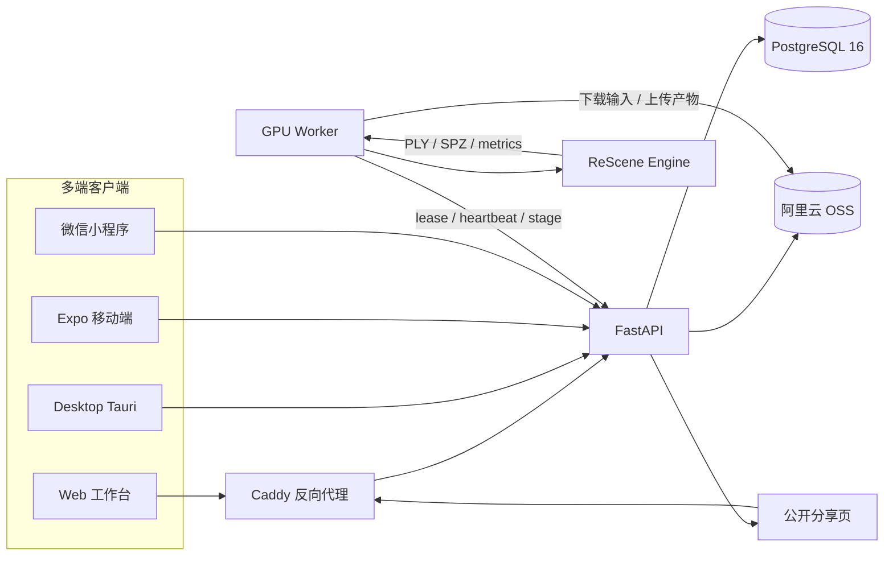
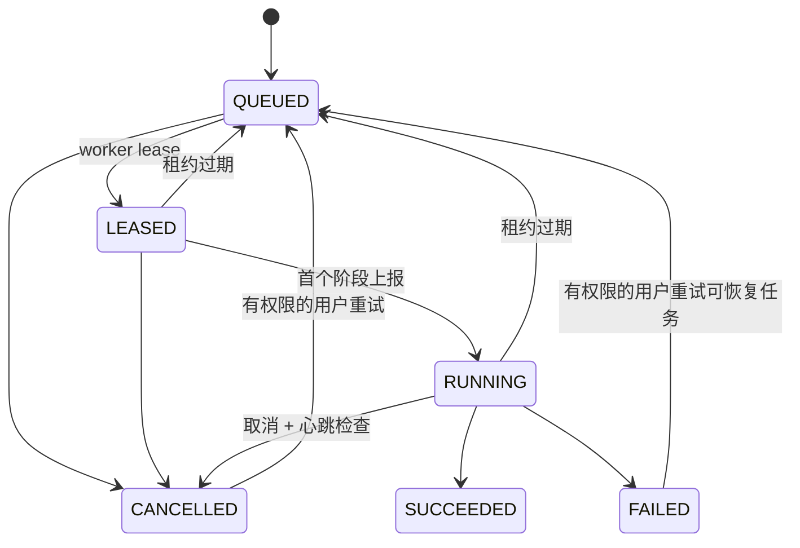

# ReScene 项目说明

> 源码版本为 0.4.1 发布候选，更新于 2026-11-20。
>
> 定位：把一组照片或一段视频转换成可在线浏览、下载和分享的 3D Gaussian Splatting 重建。  
> 相关文档：[README](../README.md) · [部署与运维](单5090系统部署与运维.md) · [5090 质量标定](5090_QUALITY_CALIBRATION.md) · [5090 标定报告](RESCENE_5090_OPTIMIZATION_REPORT.md) · [A100 历史实验](A100_OPTIMIZATION_REPORT.md) · [用户手册](用户手册.md) · [开发与发布指南](../CONTRIBUTING.md)

## 1. 项目能力

当前正式下载版为 0.4.0。0.4.1 候选已完成 5090 三路线的图片和视频交付回归，最新微信体验版已通过用户冷启动复测。生产切换前仍需完成本批客户端验收和 GPU 重新上线后的交付回归。 [候选验收](../artifacts/test-runs/2026-11-20-brand-refresh/report.md) · [官网交付状态](https://rescene.xyz/#delivery)

一条完整链路：

```text
创建项目 → 上传图片/视频 → 创建重建任务 → GPU Worker 执行
  → 预处理 → 几何 → 3DGS 训练 → 质量评估 → 导出
  → PLY / SPZ / 指标 / 报告进入对象存储
  → Web Viewer 浏览、下载、生成分享链接
```

三条重建路线：

| Profile | 几何 | 3DGS 步数 | 典型用途 |
|---|---|---|---|
| `fast` | VGGT 前馈几何 | 7,000 | 快速预览、移动端上传后即时反馈 |
| `balanced` | VGGT + BA | 20k | 默认档，画质与耗时平衡 |
| `quality` | COLMAP SfM/BA/MVS | 20k | 高精度稠密几何与最佳渲染 |

生产默认参数与历史标定见 [5090 标定报告](RESCENE_5090_OPTIMIZATION_REPORT.md) §1。该轮冻结帧与实际渲染分割不一致，历史结果不能作为新候选晋级基线；修正口径见 [v3 报告](RESCENE_5090_DELIVERY_OPTIMIZATION.md)。

**非目标**：三维编辑、实时 SLAM、多 GPU 分布式训练、地图级重建、在线协同标注。

## 2. 系统架构



部署形态：

- **控制面**：Docker Compose（`db`、`api`、`web`），Caddy 负责 TLS 与域名。
- **数据面**：阿里云 OSS（输入原图、checkpoint、产物、备份）。
- **计算面**：AutoDL RTX 5090 上的 `rescene-worker`，主动轮询 HTTPS 租约接口，通过单卡锁独占 GPU。

## 3. 仓库结构

| 路径 | 作用 |
|---|---|
| `src/rescene/` | 算法引擎：预处理、几何后端（VGGT/COLMAP）、3DGS 训练、评估、导出、选型 |
| `src/rescene_api/` | FastAPI 控制面：认证、项目、上传、任务、Worker 协议、分享 |
| `src/rescene_worker/` | GPU Worker：租约、心跳、阶段上报、checkpoint 上传/恢复、产物归档 |
| `apps/web/` | Next.js App Router 工作台与分享页 |
| `apps/desktop/` | Tauri 2 + Vite + React 桌面端 |
| `apps/mobile/` | Expo 58 / React Native 0.88，手写状态导航与系统返回键 |
| `apps/miniapp/` | Taro 微信小程序 |
| `packages/schemas` | Zod 契约与共享类型 |
| `packages/api-client` | 浏览器/Node 共用的 API 与 SSE 客户端 |
| `packages/uploader` | 分片/直传、进度、SHA-256 校验 |
| `packages/viewer` | PLY/SPZ 三维查看器 |
| `packages/workbench` | 工作台页面与状态管理（Web/桌面复用） |
| `packages/design-tokens` | 颜色、间距、字体等设计变量 |
| `configs/calibration/` | 生产选型、候选矩阵、冻结验证帧 |
| `calibration/` | 标定证据：leaderboard、selection、官方评测、BA 诊断 |
| `scripts/` | 数据下载、标定驱动、Worker 控制、发布校验 |
| `infra/` | Dockerfile、Compose、Caddy、备份、部署辅助脚本 |
| `tests/` | 引擎、API、Worker、选型、存储测试 |

## 4. 数据模型

| 表 | 关键字段 | 说明 |
|---|---|---|
| `users` | `email`、`password_hash`、`is_admin`、`token_version` | 账号；`token_version` 用于注销/失效 |
| `projects` | `owner_id`、`name`、`deleted_at` | 软删除项目 |
| `project_members` | `project_id`、`user_id`、`role` | `member`（可写）/ `viewer`（只读）；owner 与 admin 直接放行 |
| `assets` | `project_id`、`object_key`、`size`、`sha256`、`status` | 输入文件；`UPLOADING` → `READY` |
| `reconstruction_jobs` | `profile`、`status`、`priority`、`progress`、`leased_by`、`lease_expires_at`、`attempt`、`resume_artifact_key` | 任务与租约 |
| `job_stages` | `job_id`、`stage`、`status`、`progress`、`metrics` | 阶段事件，兼作 SSE 数据源 |
| `worker_nodes` | `id`、`status`、`gpu_name`、`last_seen_at` | Worker 心跳 |
| `reconstructions` | `job_id`、`version`、`status`、`quality_score` | 重建结果版本 |
| `artifacts` | `reconstruction_id`、`kind`、`object_key`、`sha256`、`size` | 产物索引 |
| `shares` | `reconstruction_id`、`token_hash`、`expires_at`、`revoked_at` | 分享链接，只存 token 哈希 |
| `audit_logs` | `actor_id`、`project_id`、`action`、`target_type`、`target_id`、`metadata_json` | 全局与项目操作审计 |
| `project_invitations` | `project_id`、`email`、`role`、`invited_by` | 待注册邮箱邀请 |
| `announcements` | `title`、`body`、`level`、`created_by` | 平台公告 |
| `notifications` | `user_id`、`kind`、`job_id`、`announcement_id`、`read_at` | 任务和公告通知 |
| `job_logs` | `job_id`、`attempt`、`level`、`message` | Worker 运行日志 |

任务状态机：



任务默认最多执行 3 次。手动重试会重新排队，领取时增加 `attempt`，并保留历史阶段。素材无效时 API 返回 `409` 和 `X-Error-Code: job.invalid_input`，原失败记录保留。

## 5. API

- Base：`https://api.rescene.xyz`，OpenAPI 在 `/docs`。
- 认证：`Authorization: Bearer <JWT>`；JWT HS256，`token_version` 不匹配即失效。
- 任务事件使用 `GET /v1/jobs/{job_id}/events?lastEventId=<事件ID>`。API 按 `(created_at, id)` 每次读取最多 100 条 `stage` 事件，补齐后发送 `final`。游标失效返回 `422`，共享客户端重新获取任务状态并切换轮询。

| 分组 | 代表性端点 | 说明 |
|---|---|---|
| 健康 | `GET /health/live`、`GET /health/ready` | 就绪检查校验数据库连通性 |
| 认证 | `POST /v1/auth/register`、`/v1/auth/login`、`/v1/auth/password`、`/v1/auth/refresh`、`/v1/auth/logout` | 邮箱注册、登录、自助改密与会话管理 |
| 用户 | `GET/POST /v1/users`、`GET/PATCH /v1/users/{id}`、`POST /v1/users/{id}/password` | 平台管理员查询、创建和管理账号 |
| 项目 | `GET/POST /v1/projects`、`GET/PATCH/DELETE /v1/projects/{id}`、`POST .../members`、`GET .../invitations`、`DELETE .../invitations/{invitation_id}` | 项目管理、成员与待处理邀请 |
| 公告与通知 | `GET/POST /v1/announcements`、`DELETE /v1/announcements/{id}`、`GET /v1/notifications`、`GET /v1/notifications/count`、`POST /v1/notifications/read` | 管理员发布公告；用户读取通知和未读数 |
| 审计 | `GET /v1/audit`、`/v1/audit/actions`、`/v1/audit.csv`、`/v1/projects/{id}/audit` | 全局审计仅平台管理员；项目审计按项目权限 |
| 上传 | `POST .../assets/upload-session`、`POST /v1/assets/{id}/complete`、`POST /v1/assets/{id}/upload-session` | STS 或 PostObject 授权；complete 校验 size + SHA-256 |
| 任务 | `POST /v1/projects/{id}/jobs`、`GET /v1/jobs/{id}`、`GET .../stages`、`GET .../logs`、`POST .../cancel`、`POST .../retry` | 图片或单个视频输入；阶段历史与运行日志 |
| Worker | `POST /v1/worker/lease`、`/v1/worker/jobs/{id}/heartbeat`、`.../stage`、`.../logs`、`.../complete`、`.../fail`、`.../credentials` | Worker token 保护，日志尽力上报 |
| 产物 | `GET /v1/reconstructions/{id}/manifest` | 返回每个 artifact 的签名 URL、SHA-256、大小 |
| 分享 | `POST /v1/reconstructions/{id}/shares`、`DELETE /v1/shares/{id}`、`GET /v1/public/shares/{token}` | 可设过期时间；公开读取 300 s 签名 URL |
| Worker 状态 | `GET /v1/workers/status` | 运维与前端提示 |

`GET /v1/users` 和项目审计返回 `{total, items}`；与 0.2.x 的数组响应不兼容。全局审计支持筛选和分页，CSV 最多 10000 行。

输入限制：单任务最多 500 个资产、总大小 ≤ 8 GiB；图片集合与视频不可混选。

## 6. 对象存储布局

| 对象 | Key |
|---|---|
| 输入原图 | `projects/{project_id}/assets/{asset_id}/original/{filename}` |
| 任务输出根 | `projects/{project_id}/jobs/{job_id}/attempts/{attempt}/` |
| 阶段 checkpoint | `.../checkpoints/{preprocess|geometry|training|export}.tar.gz` |
| 产物 | `.../artifacts/{kind}/{filename}` |
| 产物清单 | `.../artifacts/manifest/manifest.json` |

产物 `kind`：`spz`、`ply`、`dense`、`mesh`、`metrics`、`report`、`manifest`。其中 `spz/ply/metrics/report` 四类缺失时任务直接失败，避免“成功但没有可交付物”。

上传授权两种模式：

- `sts`：临时 STS 凭证，前端分片直传，适合大文件；
- `post`：PostObject 表单，单文件 ≤ 5 GiB，适合小程序等简单客户端。

完成后服务端 `HEAD` 对象并核对大小与 SHA-256，通过才把资产置为 `READY`。

## 7. Worker 与调度

- 轮询 `POST /v1/worker/lease`，默认 5 s；API 侧全局只允许一个 `LEASED/RUNNING` 任务，天然 GPU 独占。
- 租约 90 s；下载、归档、上传等长操作期间由心跳线程续租。
- 每个阶段开始/结束都上报 `job_stages`，前端通过 SSE 获取进度。Worker 增量采集运行日志，尽力上报；每任务默认保留最近 2000 行，可由 `RESCENE_JOB_LOG_LIMIT` 调整。日志缺失可能有多种原因，不能直接判定任务失败。
- 每个阶段结束上传 checkpoint；阶段上报时 API 校验 checkpoint 位于该任务当前 attempt 的归档前缀。重试可使用任务记录的已有 checkpoint 恢复，无可用归档时重新开始。
- 取消：心跳发现 `cancel_requested` 或租约丢失时，终止进程组并清理。
- 完成前检查租约，避免“取消后仍发布产物”。
- 失败将 `error_code` / `error_message` 写回任务，前端可直接展示。

运维命令（GPU 主机上）：

```bash
./workerctl start     # 启动 worker
./workerctl drain     # 停止接新任务，等待在跑任务
./workerctl stop
./workerctl status
./workerctl logs
./workerctl smoke     # CUDA / gsplat / 显存自检
```

## 8. 引擎流水线

| 阶段 | 产物 | 说明 |
|---|---|---|
| `preprocess` | `images/`、`manifest.json` | 图片发现、EXIF 方向、视频抽帧、模糊/曝光/去重、选帧、输入哈希 |
| `geometry` | `sparse/`、`geometry.json` | VGGT 或 COLMAP；可选 BA 诊断、稠密重建 |
| `training` | `gsplat/`、`scene.ply` | gsplat 优化，步数由 profile 决定 |
| `evaluation` | `metrics.json`、`report.md` | PSNR/SSIM/LPIPS、注册率、验证帧、BA 指标 |
| `export` | `scene.spz`、checkpoint | SPZ 压缩与阶段归档 |

- 阶段结果写入 `stages/*.json`，`--resume` 时跳过已完成阶段；输入哈希变化会使旧阶段失效。
- Worker 任务至少保留一半已选验证图时，可以使用仍已注册的原留出图评分，并在指标中记录缺失源图。留出图始终排除在 Gaussian 优化之外，冻结基准沿用各自的完整性规则。
- 生产配置在 `src/rescene/config.py` 的 `PROFILES`；标定选型在 `configs/calibration/selected-v2.json`，二者必须保持一致。
- CLI 示例：以下重建和 benchmark 需要完成 GPU、CUDA 与模型环境配置；`./photos` 需替换为已有素材目录。开发环境配置见[开发与发布指南](../CONTRIBUTING.md)。

```bash
python -m rescene --help
python -m rescene run --profile balanced --input ./photos --run-id example-balanced
python -m rescene benchmark --input ./photos --profiles fast --repeat 3 --run-prefix example-benchmark
python -m rescene report --run-id example-balanced
```

## 9. 多端客户端

| 端 | 技术 | 入口 | 能力 |
|---|---|---|---|
| Web | Next.js App Router | `/`、`/viewer`、`/share/[token]` | 登录、项目、上传、创建任务、进度 SSE、Viewer、分享 |
| Desktop | Tauri 2 + Vite + React | `apps/desktop` | 复用 Web 工作台；Rust 命令缓存远端产物到本地 |
| Mobile | Expo 58 / React Native | `apps/mobile` | 项目列表、项目详情、Viewer、图片/视频上传 |
| 小程序 | Taro（微信） | `apps/miniapp` | 邮箱注册与登录、OSS 直传、任务轮询、复制链接到手机浏览器查看场景 |

四端均有管理控制台、通知与任务日志。0.4.1 候选版的共享客户端同时读取现行服务器的完整项目响应和新 API 的分页响应。Web/Windows 将素材、任务和结果分区。正式安装包及候选验证分别见 [0.4.0 发布说明](0.4.0发布说明.md) 和 [0.4.1 验收报告](../artifacts/test-runs/2026-11-20-release-041/report.md)。

个人主体小程序使用邮箱密码登录，并经手机浏览器打开 Viewer。正式发布需核对真实 AppID、服务器域名、隐私指引、服务类目与平台审核。 [用户手册](用户手册.md#微信小程序)

共享策略：

- `packages/workbench` 承载页面逻辑，Web 与桌面端只做壳；
- `packages/viewer` 统一 PLY/SPZ 渲染与相机交互；
- `packages/uploader` 统一直传、进度与校验，各端只注入平台适配器；
- `packages/api-client` 统一鉴权、错误映射与 SSE 解析。

## 10. 认证、权限与分享

- 密码使用 scrypt（N=2^14、r=8、p=1，最短 12 位）；登录返回访问令牌。
- 注销会递增 `token_version`，旧令牌立即失效。
- 平台管理员是账号级权限，能管理所有项目和全局账号，不是项目成员角色；项目 owner 可管理自己的项目，`member` 可读写及管理分享，`viewer` 只读。成员关系按 `project_id` 校验。
- 开放自助注册：`POST /v1/auth/register`（邮箱唯一、密码至少 12 位）成功后直接签发访问令牌；管理员仍可建号。自助改密验证旧密码并令旧 token 失效，返回新 token。
- 项目 owner 或平台管理员可按邮箱添加成员；未注册邮箱形成待处理邀请，同邮箱注册时自动加入。系统不自动发邮件；待处理邀请可查询和撤销。
- 分享：有项目写权限者可创建、列出及撤销；只存 `sha256(token)`，支持到期时间和二维码。公开页面只暴露展示产物签名 URL 与元数据。

## 11. 部署与运维

Compose 服务：

| 服务 | 资源 | 说明 |
|---|---|---|
| `db` | 1 GB / 1.5 CPU | PostgreSQL 16，健康检查 |
| `api` | 640 MB / 2 CPU | FastAPI + Alembic 迁移 |
| `web` | 384 MB / 1 CPU | Next.js standalone |
| `backup` / `backup-upload` | tools profile | 每日备份到 OSS |

关键环境变量（`worker.env.example` 与服务端 secrets）：

```text
RESCENE_API_URL / RESCENE_WORKER_ID / RESCENE_WORKER_TOKEN_FILE
RESCENE_DB_PASSWORD_FILE / RESCENE_JWT_SECRET_FILE
RESCENE_OSS_ENDPOINT / RESCENE_OSS_BUCKET / RESCENE_OSS_ACCESS_KEY_ID
RESCENE_OSS_ACCESS_KEY_SECRET_FILE / RESCENE_OSS_ROLE_ARN
RESCENE_CORS_ORIGINS / RESCENE_ADMIN_EMAIL
```

磁盘注意：部署及运行 benchmark 前检查可用空间；`runs/` 中间产物需要保留与清理策略，数据和模型应放在容量充足的数据盘。详细步骤、回滚、备份恢复见 [单 5090 系统部署与运维](单5090系统部署与运维.md)。

## 12. 本地开发

环境安装、本地启动和检查命令以[开发与发布指南](../CONTRIBUTING.md)为准。

测试约定：

- API 测试包括 SQLite 测试与 PostgreSQL 并发专项；CI 使用 PostgreSQL 16，专项测试在未配置 `RESCENE_TEST_POSTGRES_URL` 时跳过；
- 引擎测试覆盖预处理、几何后端选择、指标、选型规则与恢复；
- 前端包各自有 typecheck 与单元测试，Web/桌面/小程序要求可构建。

## 13. 质量保障与验收

CI（`.github/workflows/check.yml`）包括以下任务：

1. Python：ruff、API schema 类型检查和 pytest；
2. Workspace：版本校验、类型检查、测试，以及 Web、Desktop、Android 导出和小程序构建；
3. Desktop shell：Rust 格式检查与 Clippy；
4. Commit messages：检查提交信息；
5. Images：构建 API 与 Web 镜像。

发布验收包括：

- API `/health/ready` 返回 200，迁移版本一致；
- Worker `smoke` 通过，`status` 为 running 且 `drain=no`；
- 端到端：登录 → 上传 → 创建任务 → SSE 进度 → 产物 manifest → 分享页可打开；
- 标定证据可复现（`calibration/` 与 `configs/calibration/`）。

## 14. 当前状态与已知限制

- 历史 v2 标定中，FAST 的 `steps5k` 因场景回退未晋级；该轮冻结帧与实际渲染分割存在不一致，结果仅供历史参考。
- 历史实验中 QUALITY 在 playground 的渲染指标低于 FAST/BALANCED，不应将其视为当前验收结论。
- 单 Worker、单任务串行；扩容需要调度层支持多 GPU。
- ETH3D 官方 evaluator 单线程，完整评分耗时较长；当前用分组并行 + 合并解决。
- benchmark 的 `runs/` 需要容量监控与清理策略。

## 15. 文档索引

| 文档 | 内容 |
|---|---|
| [README](../README.md) | 快速开始、验证命令、当前状态 |
| [单 5090 系统部署与运维](单5090系统部署与运维.md) | 服务器、Compose、Caddy、备份、回滚、磁盘 |
| [5090 质量标定](5090_QUALITY_CALIBRATION.md) | 标定流程、候选、判定、逐项结果 |
| [5090 标定报告](RESCENE_5090_OPTIMIZATION_REPORT.md) | 结论、耗时、官方评测、缺陷修复 |
| [A100 历史实验](A100_OPTIMIZATION_REPORT.md) | A100 时代的参数与结论 |
| [用户手册](用户手册.md) | 账号、使用流程、各端发布与限制 |
| [开发与发布指南](../CONTRIBUTING.md) | 开发流程、构建与发布 |
| [0.3.0 发布说明](0.3.0发布说明.md) | 发布产物、校验与限制 |
| [系统剩余任务与实施路线图](系统剩余任务与实施路线图.md) | 产品化历史规划与当前完成状态 |
